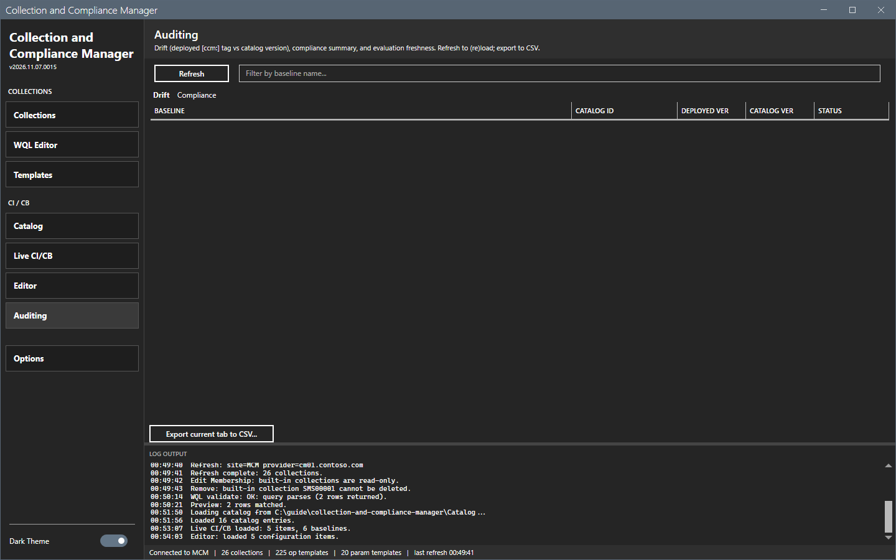
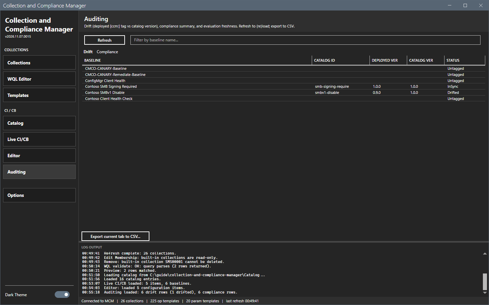
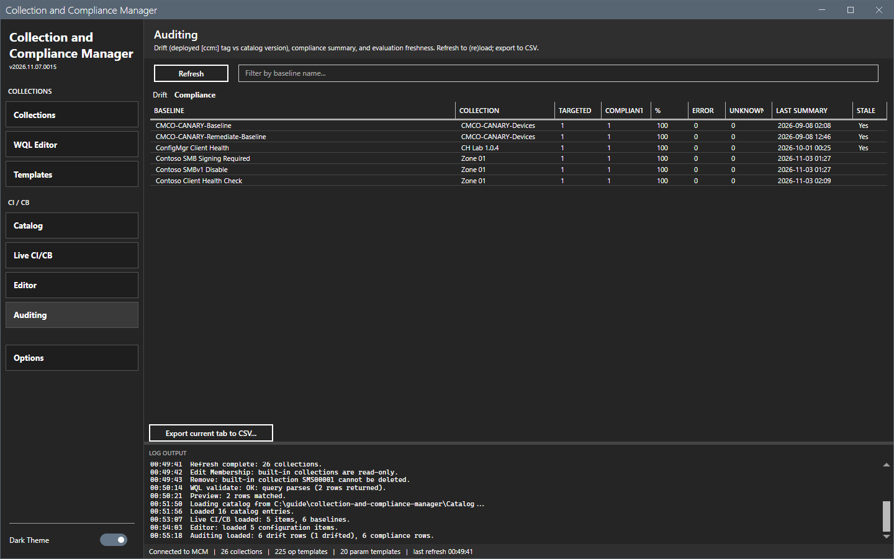

# Auditing

The Auditing view compares the deployed baselines with the catalog and summarizes compliance.

## What it does

The **Drift** tab compares the deployed baseline version, read from its `[ccm:]` tag, with the catalog version. The **Compliance** tab shows the compliance summary of each collection and how fresh the evaluation is. **Export current tab to CSV...** saves the tab.

## When to use it

Use it to find baselines that are older than the catalog, and to find collections that do not evaluate.

## Requirements

- A connection and the catalog path in [Options dialog](options.md).

## Steps

1. Select **Auditing** in the sidebar. The view is empty.

2. Select **Refresh**. The log shows `Auditing loaded: <n> drift rows (<n> drifted), <n> compliance rows.`

3. Select the **Compliance** tab.

4. To save a tab, select **Export current tab to CSV...** and select **Save** in the dialog.

## Options and settings of this page

| Control | Effect |
|---|---|
| **Refresh** | Reads drift and compliance. |
| Filter box | Filters by baseline name. |
| **Export current tab to CSV...** | Saves the selected tab. |

## Limits

- Only baselines with a `[ccm:<id>@<version>]` tag are compared with the catalog.
- The view reads the site when you refresh.

## Troubleshooting

| Message or symptom | Cause | Fix |
|---|---|---|
| `Auditing load failed:` | The read failed. | Read the log. |
| The Drift tab is empty. | No baseline has a ccm tag. | Deploy an entry from [Catalog](catalog.md). |

## Links

- [Catalog](catalog.md)
- [Live CI/CB](live-cicb.md)
