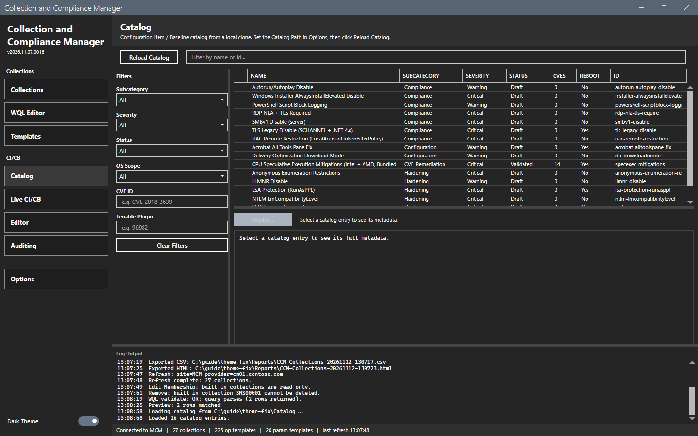
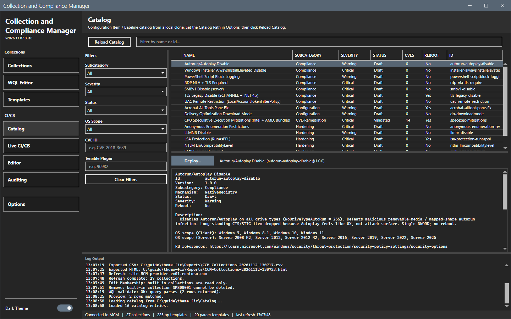
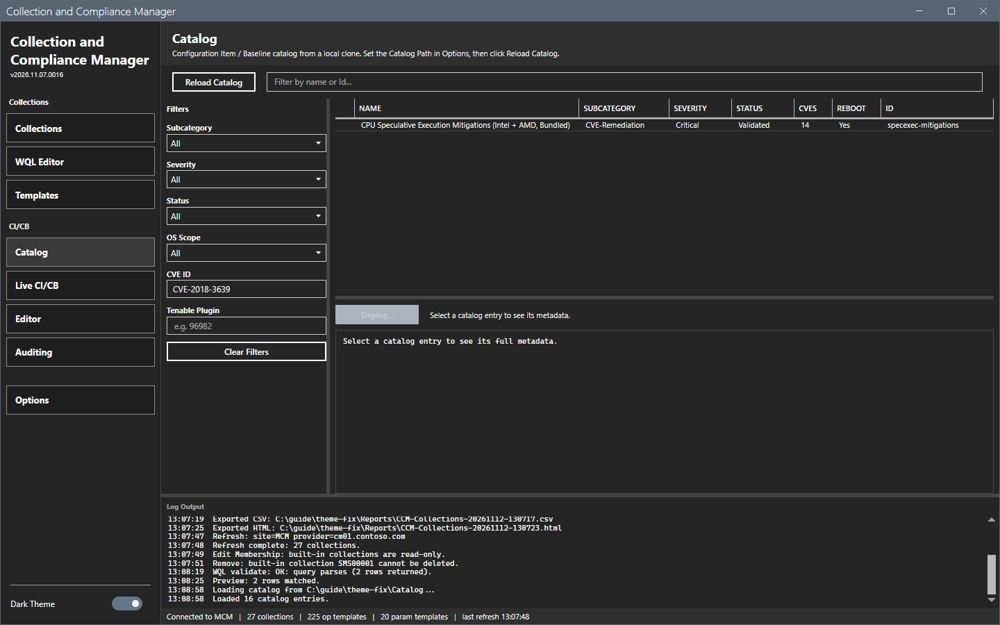
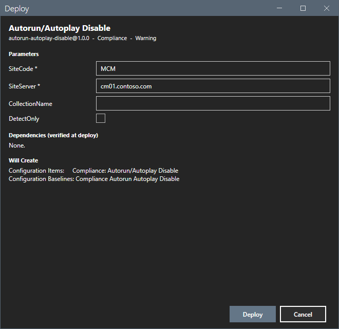

# Catalog

The Catalog view lists the bundled catalog of configuration items and configuration baselines.

## What it does

The catalog is the folder `Catalog` beside the script. It has 16 entries in four subcategories: Compliance, Configuration, CVE-Remediation and Hardening. Each entry has metadata and a builder script. **Deploy...** shows a form for the entry, checks its dependencies, asks for a confirmation, runs the builder on the site and tags the baseline with `[ccm:<id>@<version>]`.

## When to use it

Use it to find an entry by subcategory, severity, status, operating system, CVE or Tenable plugin, and to deploy it.

## Requirements

- The **Catalog Path** in [Options dialog](options.md). It points to the folder that holds the subcategory folders.
- For **Deploy...**: a refresh and the right to create configuration items and baselines.

## Steps

### Load the catalog

1. Select **Options > Catalog**, type the path or select **Browse...**, and select **OK**.
2. Select **Catalog** in the sidebar and select **Reload Catalog**. The log shows `Loaded 16 catalog entries.`

### Read an entry

1. Select a row. The pane below the grid shows the full metadata. The text next to **Deploy...** shows the name.

### Filter the catalog

1. Type text in the filter box to filter by name or ID.
2. Use the lists **Subcategory**, **Severity**, **Status** and **OS Scope**, and the boxes **CVE ID** and **Tenable Plugin**.
3. Select **Clear Filters** to remove every filter.

### Deploy an entry

1. Select a row and select **Deploy...**. The dialog `Deploy` shows the entry, its parameters (a star marks a required one), the dependencies and what it will create.
2. Fill the parameters. The site code and the site server are filled from the connection.
3. Select **Deploy** to run the builder or **Cancel**.

This guide opened the dialog and cancelled it. The result of **Deploy** was not checked. If a dependency is missing, the log shows `Deploy blocked: <n> dependency/dependencies missing:` and the status bar shows `Deploy blocked: missing dependencies.`

## Options and settings of this page

| Control | Effect |
|---|---|
| **Reload Catalog** | Reads the catalog folder again. |
| Filter box and the filter fields | Filter the grid. |
| **Clear Filters** | Removes every filter. |
| **Deploy...** | Opens the deploy dialog for the selected entry. |

## Limits

- **Deploy...** needs a refresh, because it needs the site connection. Without it the status bar shows `Deploy needs a site connection -- Refresh first.`
- The catalog schema is in the repository file `docs\CATALOG-SCHEMA.md`.

## Troubleshooting

| Message or symptom | Cause | Fix |
|---|---|---|
| `Open Options and set the Catalog Path` | The path is empty. | Set the **Catalog Path**. |
| `Catalog path not found:` | The folder does not exist. | Correct the path. |
| `Deploy: <entry> has schema issues; not deployable.` | The entry metadata is not valid. | Correct the metadata. |

## Links

- [Live CI/CB](live-cicb.md)
- [Auditing](auditing.md)
