# Collections

The Collections view lists every device collection of the site and the actions on a collection.

## What it does

The grid shows the name, the ID, the member count, the limiting collection, the refresh type and the comment of each collection. The tabs below the grid show the properties, the direct members and the query, include and exclude rules of the selected collection. The buttons create, copy, edit, evaluate and remove collections.

## When to use it

Use it to find a collection, to read its rules and to create or change a collection.

## Requirements

- A connection and a refresh. See [Getting started](../getting-started.md).
- For the buttons: rights to create, change and delete device collections.

## Steps

### Read a collection

1. Select **Refresh**, then select a row.
2. Read the **Properties** tab. It shows the name, the ID, the member count, the limiting collection, the refresh type, whether the collection is built-in, and the comment.

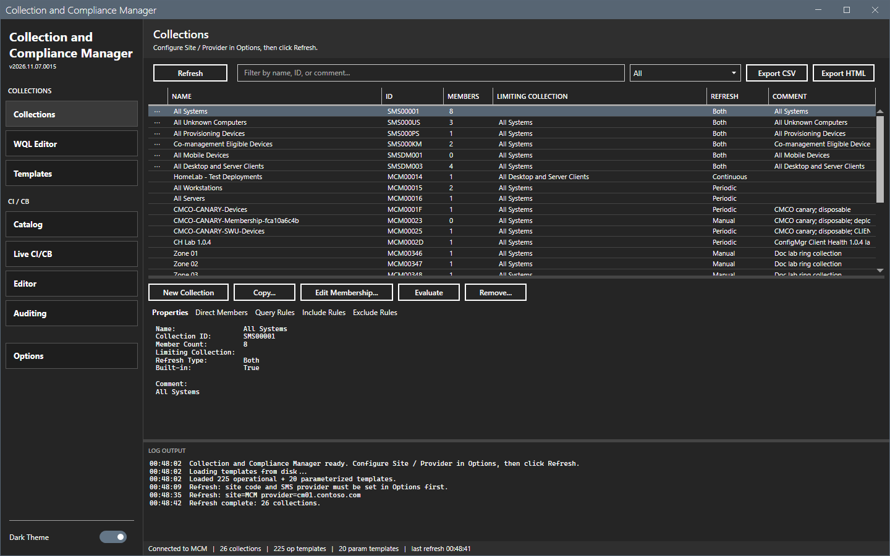

3. Select **Direct Members**, **Query Rules**, **Include Rules** or **Exclude Rules** to read the rules. The tool loads the direct members when you select the tab.

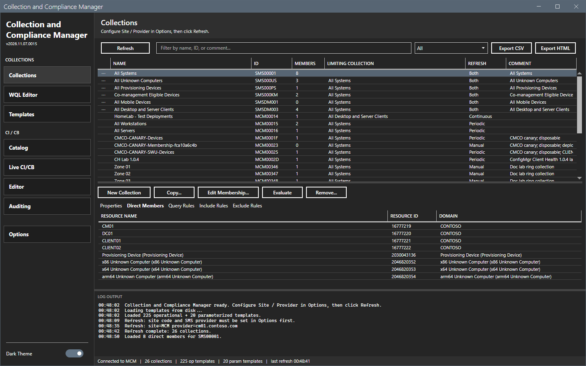

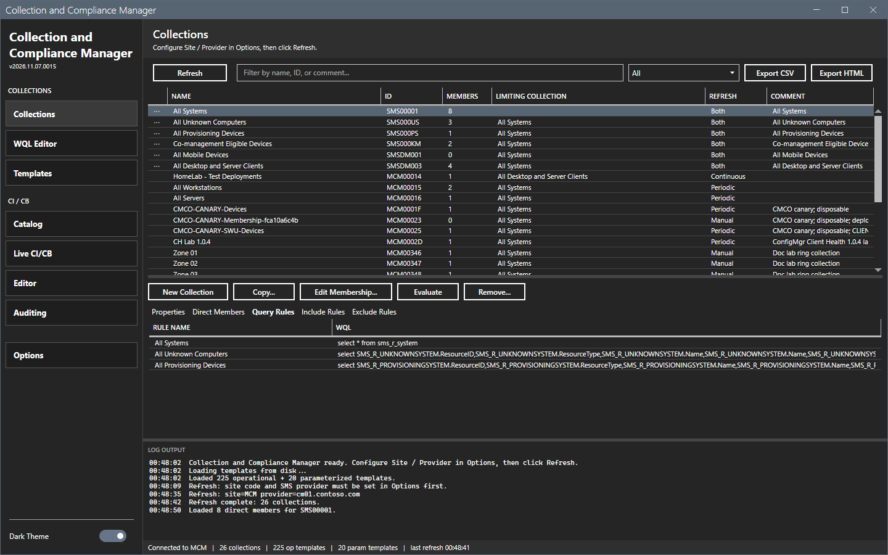

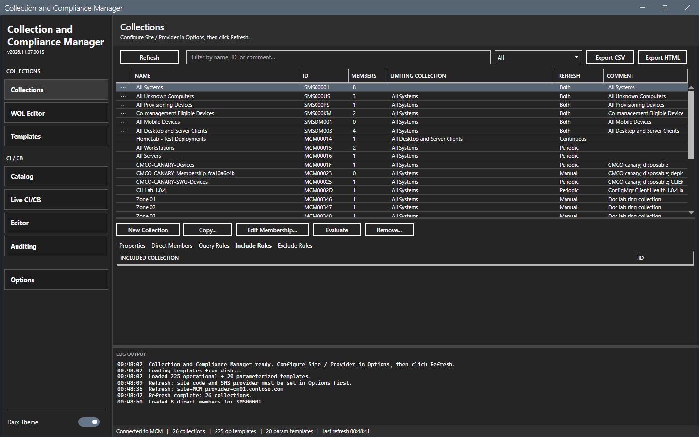

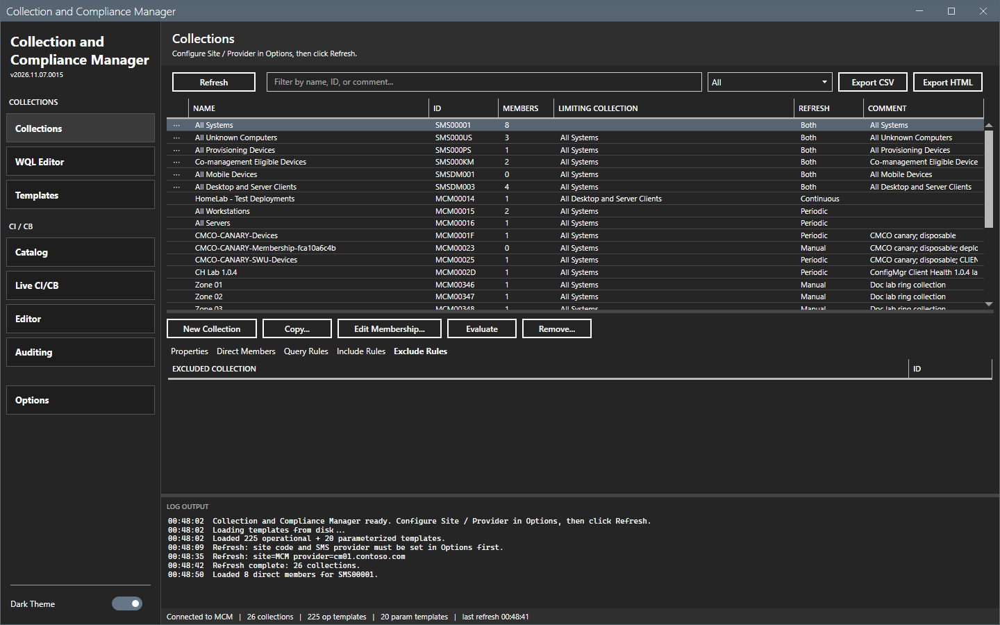

### Filter the grid

1. Type text in the filter box. The grid matches the name, the ID and the comment.
2. Select a shape in the list: **All**, **Built-in only**, **Custom only**, **Empty (zero members)** or **Has direct members**.

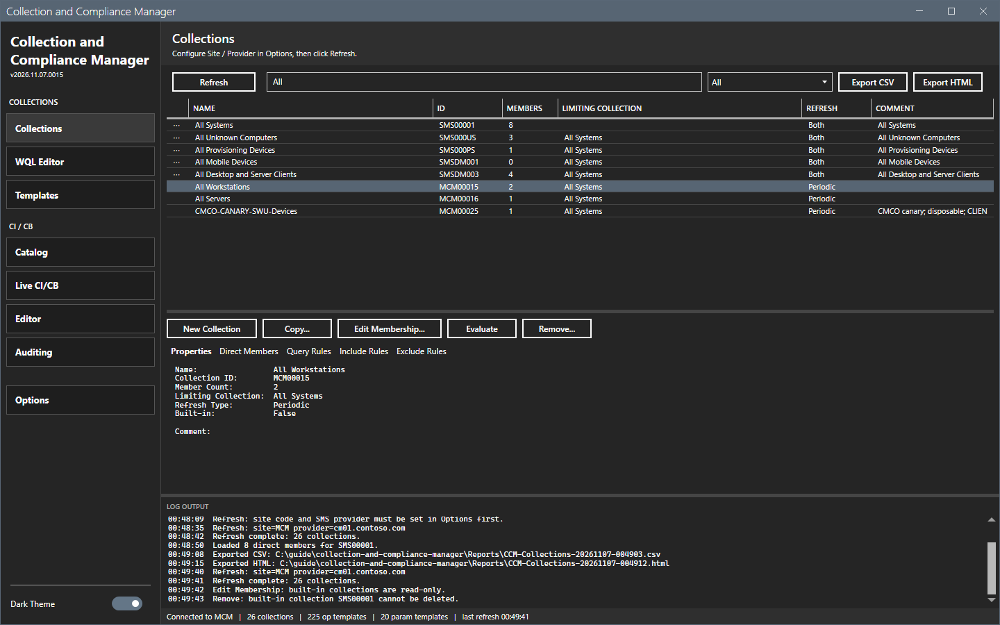

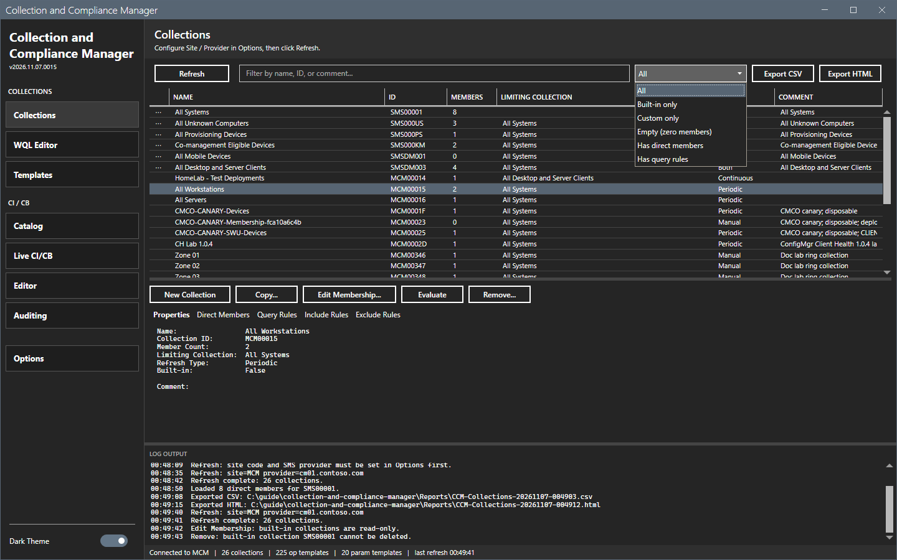

### Export the grid

1. Select **Export CSV** or **Export HTML**.
2. In the Save As dialog, keep the name or type a new name. The folder is `Reports` beside the script. The name is `CCM-Collections-<date>-<time>`.
3. Select **Save**. The log shows `Exported CSV:` and the path.

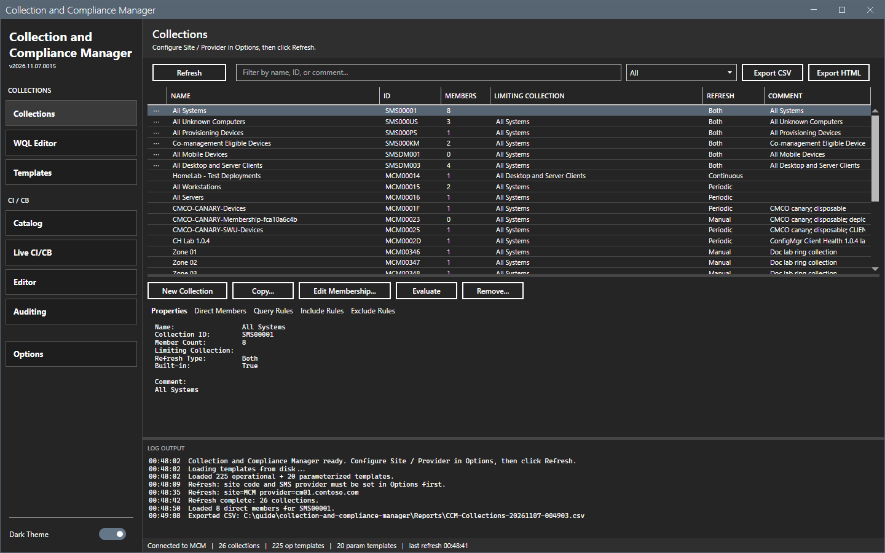

### Create a collection

1. Select **New Collection**. The dialog `New Collection` opens.
2. Type a name. Select **Browse...** to pick the limiting collection. Type a comment. Select the refresh type.
3. Select **Create**. The log shows `Created collection "<name>" (limiting: <name>, refresh: <type>).`

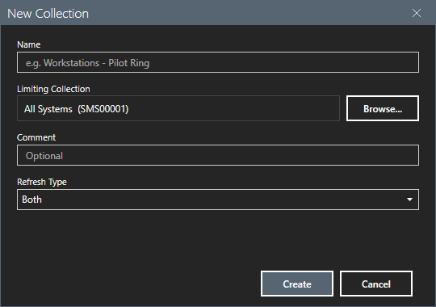

### Copy a collection

1. Select a custom collection. The row shows its properties.

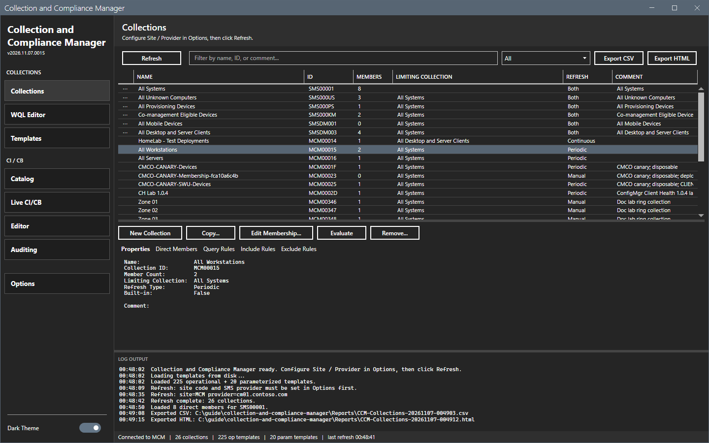

2. Select **Copy...**. The dialog `Copy Collection` shows the source.
3. Type the new name and select **Copy**. The log shows `Copied "<source>" -> "<name>".`

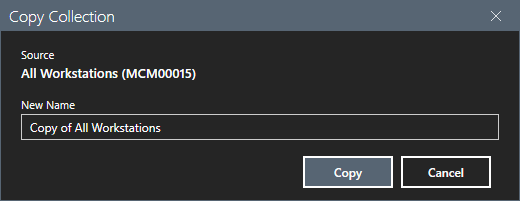

### Edit the direct members

1. Select a custom collection and select **Edit Membership...**. The dialog lists the direct members with the name, the resource ID and the domain.
2. To add a device, type its name and select **Add Direct Member**. The tool resolves the resource ID. The name must match one device exactly.
3. To remove devices, select them and select **Remove Selected**. A confirmation asks before the tool removes them.
4. Select **Reload** to read the members again.

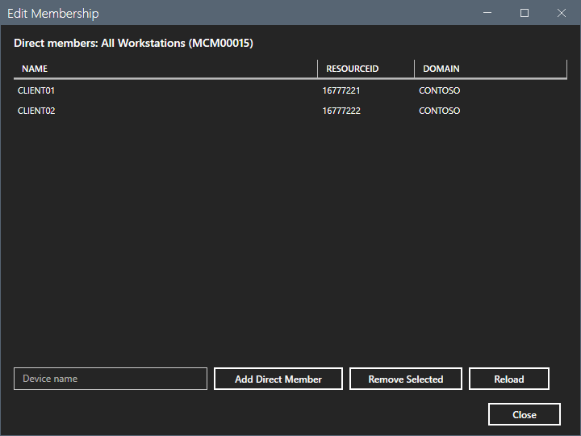

### Evaluate a collection

Select a collection and select **Evaluate**. The tool starts a membership evaluation on the site. The log shows `Triggered membership evaluation for <ID>.` This guide did not run it.

### Remove a collection

1. Select a custom collection and select **Remove...**. The dialog `Remove Collection` asks `Permanently delete collection '<name>' (<ID>)?`
2. Select **No** to keep the collection or **Yes** to delete it.

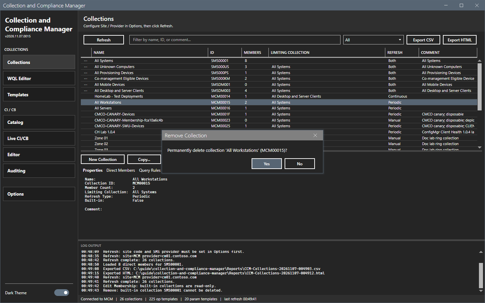

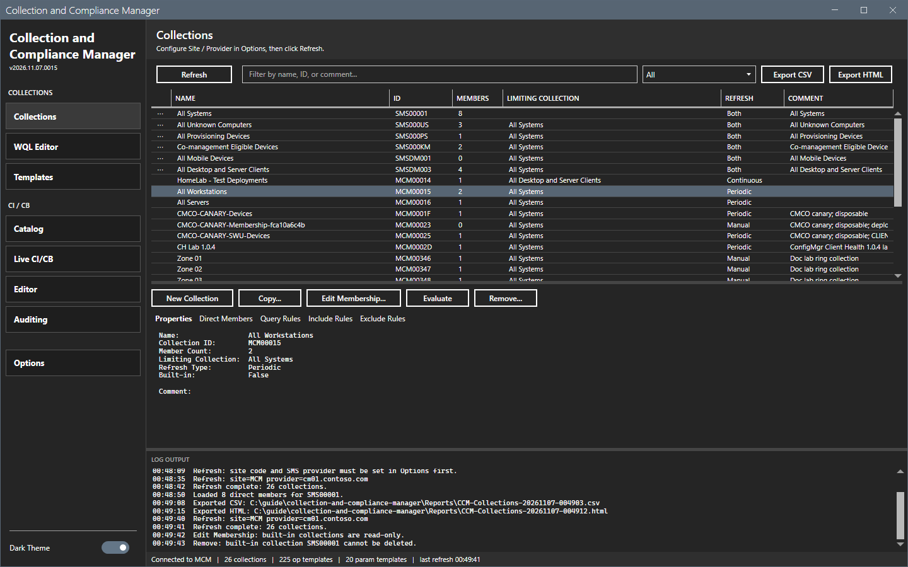

This guide answered **No**. The result of **Yes** was not checked.

### Built-in collections

A built-in collection has an ID that starts with `SMS`. The tool does not change it. **Edit Membership...** and **Remove...** write a message in the log and open nothing.

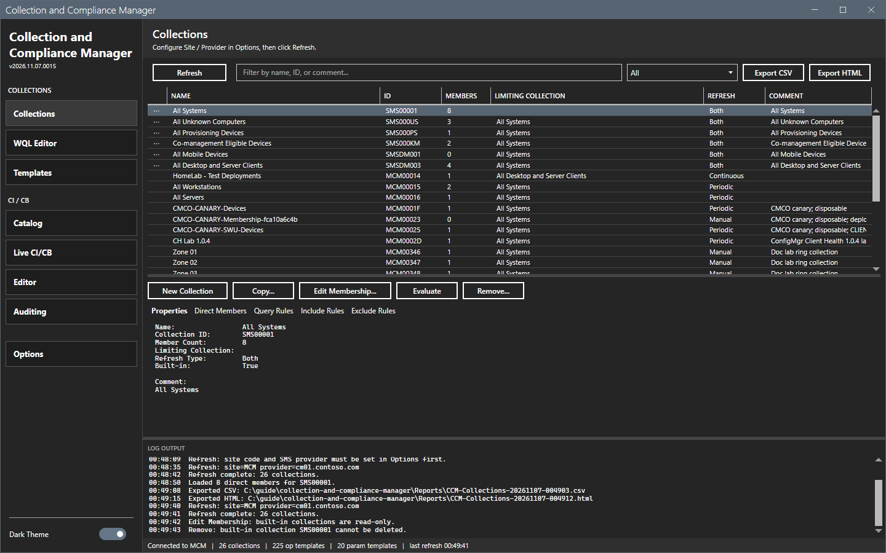

## Options and settings of this page

| Control | Effect |
|---|---|
| **Refresh** | Reads every device collection. |
| Filter box and shape list | Filter the grid. |
| **Export CSV**, **Export HTML** | Write the shown rows. |
| **New Collection**, **Copy...**, **Edit Membership...**, **Evaluate**, **Remove...** | Change the site. |

## Limits

- The buttons that change a collection are disabled until a row is selected.
- The direct members load when you open the tab or the dialog. A large collection takes longer.
- The tool does not delete a built-in collection.

## Troubleshooting

| Message or symptom | Cause | Fix |
|---|---|---|
| `Edit Membership: built-in collections are read-only.` | The collection is built-in. | Select a custom collection. |
| `Remove: built-in collection <ID> cannot be deleted.` | The same. | Select a custom collection. |
| `Add direct member: no device was added for "<name>".` | The name does not match one device, or the lookup failed. | Type the exact device name. Read the log. |

## Links

- [WQL Editor](wql-editor.md)
- [Templates](templates.md)
- [Permissions](../reference/permissions.md)
