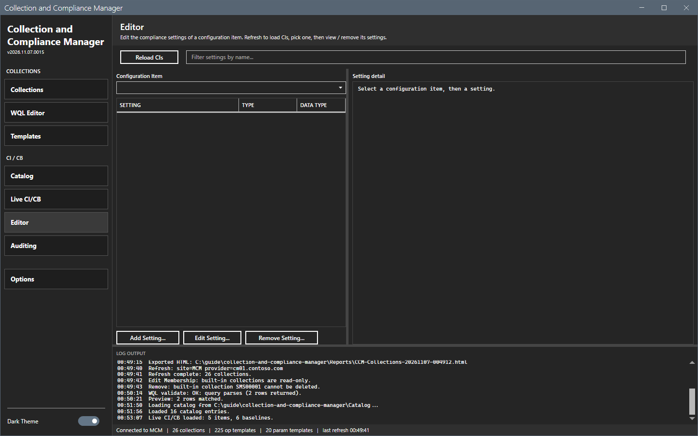
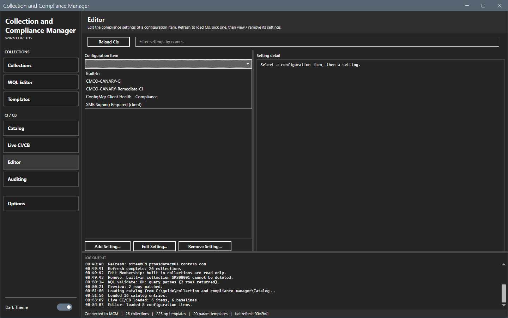
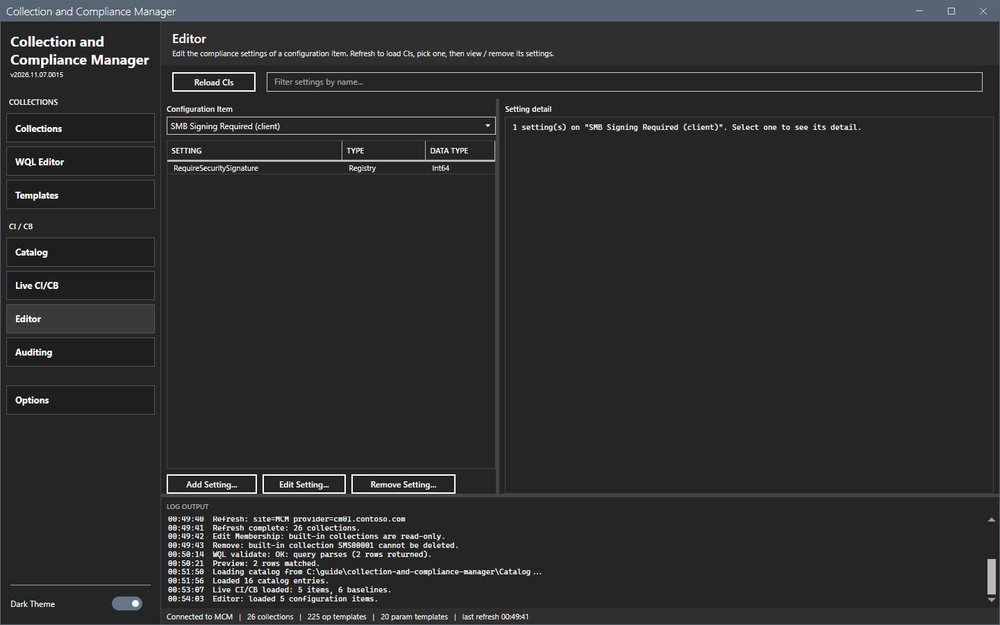
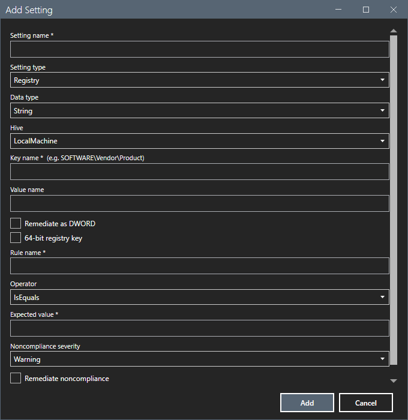

# Editor

The Editor view shows and changes the compliance settings of one configuration item.

## What it does

Pick a configuration item to see its settings with the type and the data type. **Add Setting...**, **Edit Setting...** and **Remove Setting...** change a registry or script setting. The edit dialog fills in the current values and applies only what you change.

## When to use it

Use it to add or correct a registry or script setting of a configuration item.

## Requirements

- A connection.
- The right to change configuration items.

## Steps

### Load the items

1. Select **Editor** in the sidebar.

2. Select **Reload CIs**. The log shows `Editor: loaded <n> configuration items.`

### Pick an item

1. Open the **Configuration Item** list.

2. Select an item. The grid shows its settings. Select a setting to read it in the **Setting detail** pane.

### Add a setting

1. Select **Add Setting...**. The dialog `Add Setting` opens.
2. Type the setting name. Select the setting type, **Registry** or **Script**. For a registry setting, select the data type and the hive, type the key name and the value name, and set **Remediate as DWORD** and **64-bit registry key** if needed.
3. Type the rule name, select the operator, type the expected value, select the noncompliance severity and set **Remediate noncompliance** if needed.
4. Select **Add**. The log shows `Editor: adding <type> setting "<name>" to "<item>"...`

This guide opened the dialog and cancelled it. The results of **Add**, **Edit Setting...** and **Remove Setting...** were not checked.

## Options and settings of this page

| Control | Effect |
|---|---|
| **Reload CIs** | Reads the items again. |
| Filter box | Filters the settings by name. |
| **Add Setting...**, **Edit Setting...**, **Remove Setting...** | Change the item. |

## Limits

- Only registry and script settings can be edited. For other types the log shows `Editor: "<name>" is a <type> setting -- only Registry and Script settings can be edited here.`
- The list is empty until you select **Reload CIs**.

## Troubleshooting

| Message or symptom | Cause | Fix |
|---|---|---|
| `Editor: CI load failed:` | The read failed. | Read the log. |
| `Editor: add setting failed:` | The site refused the setting. | Read the log line for the reason. |

## Links

- [Live CI/CB](live-cicb.md)
- [Catalog](catalog.md)
