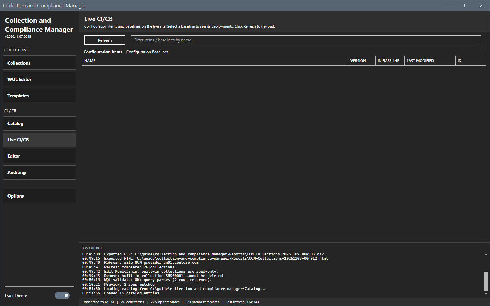
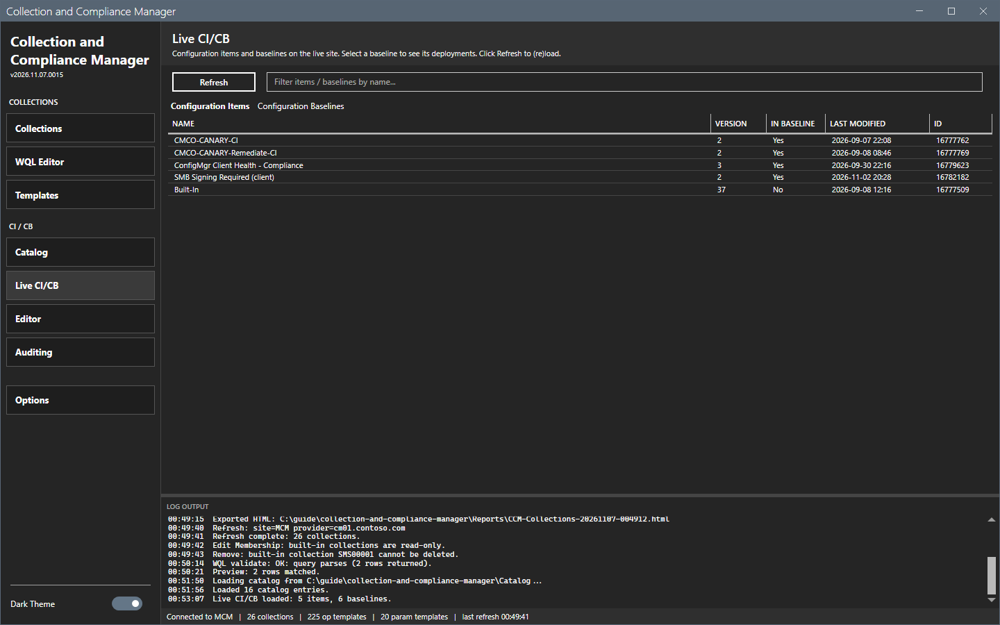
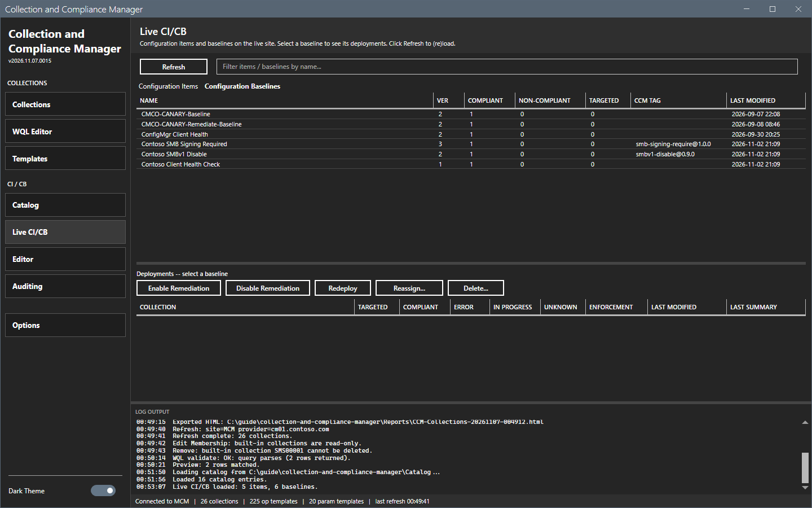
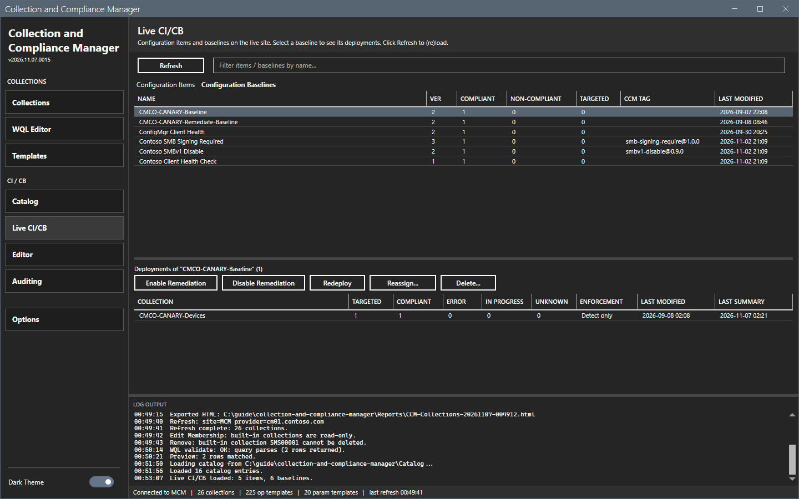

# Live CI/CB

The Live CI/CB view shows the configuration items and the configuration baselines of the connected site.

## What it does

The **Configuration Items** tab lists each item with the version, whether it is in a baseline, the number of settings and the modification time. The **Configuration Baselines** tab lists each baseline with its compliant, non-compliant and targeted counts, the number of deployments and its ccm tag. A selected baseline shows its deployments with the counts and the enforcement. The buttons below act on the selected deployments.

## When to use it

Use it to see what is on the site, to see how a baseline is deployed, and to change the deployments of a baseline.

## Requirements

- A connection. See [Getting started](../getting-started.md).
- For the deployment buttons: the right to change baseline deployments.

## Steps

### Load the view

1. Select **Live CI/CB** in the sidebar. The view is empty.

2. Select **Refresh**. The log shows `Live CI/CB loaded: <n> items, <n> baselines.`

### Read the baselines

1. Select the **Configuration Baselines** tab.
2. Select a baseline. The deployments of the baseline show below with the counts.

### Act on deployments

1. Select one or more deployments of the baseline.
2. Select **Enable Remediation**, **Disable Remediation**, **Redeploy**, **Reassign** or **Delete**. The tool asks for a confirmation before it changes the site.
3. The log shows `Live action <name> complete: <n> ok, <n> failed.`

This guide selected a baseline and read it. It did not use the deployment buttons. Their results were not checked.

## Options and settings of this page

| Control | Effect |
|---|---|
| **Refresh** | Reads the items and the baselines. |
| Filter box | Filters items and baselines by name. |
| **Enable Remediation**, **Disable Remediation**, **Redeploy**, **Reassign**, **Delete** | Change the selected deployments. |

## Limits

- The view reads the site when you refresh.
- The actions work on deployments, not on items.

## Troubleshooting

| Message or symptom | Cause | Fix |
|---|---|---|
| `Live CI/CB load failed:` | The read failed. | Read the log. Check the connection. |
| The deployment buttons are disabled. | No deployment is selected. | Select a baseline and a deployment. |

## Links

- [Catalog](catalog.md)
- [Auditing](auditing.md)
