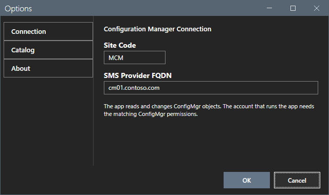
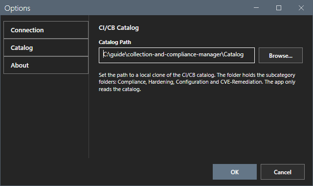
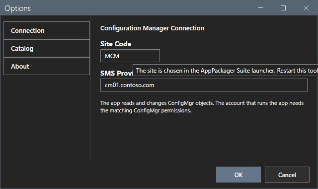
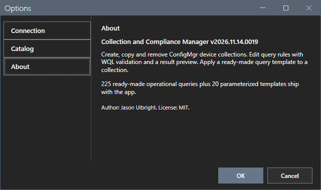
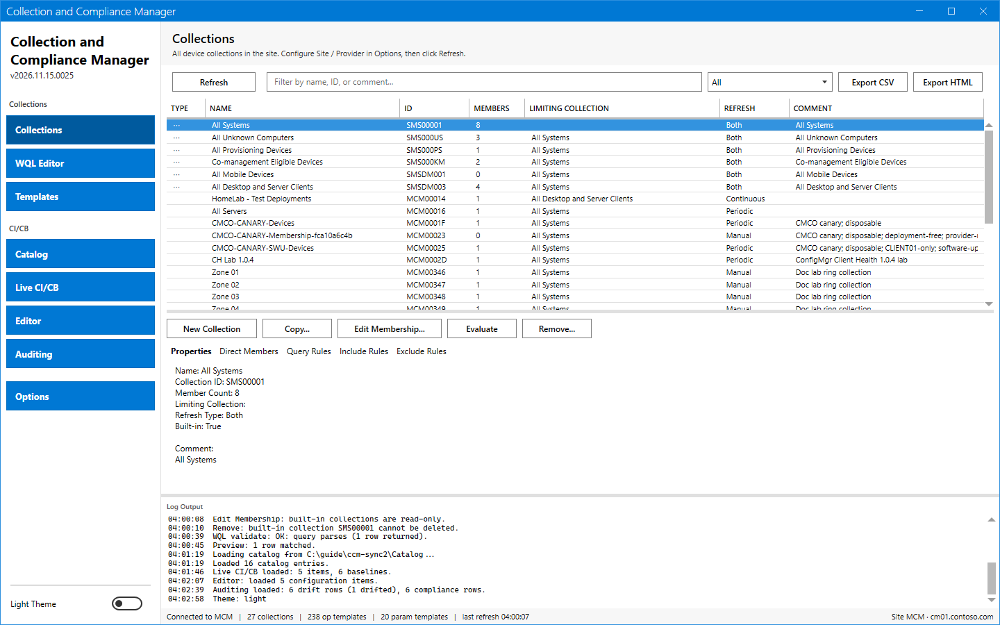
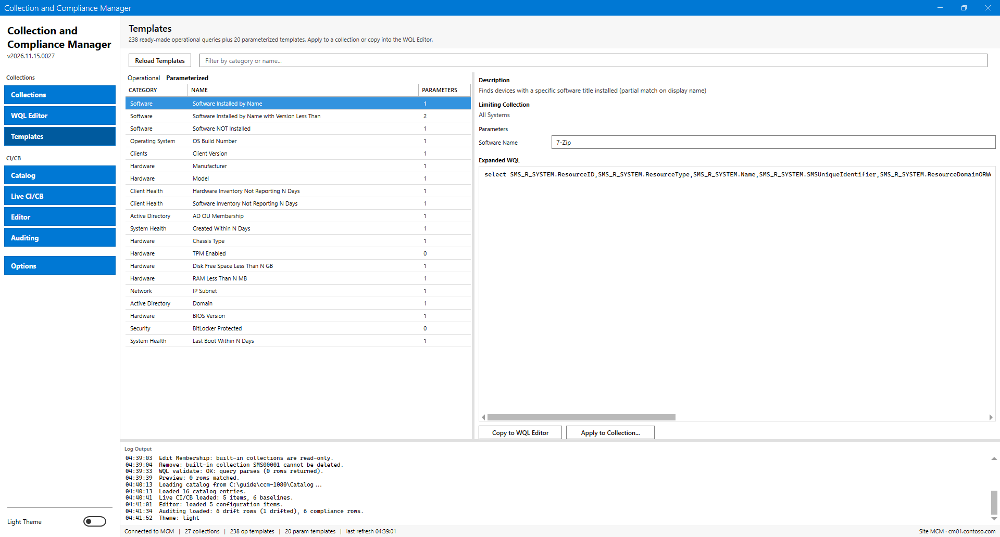
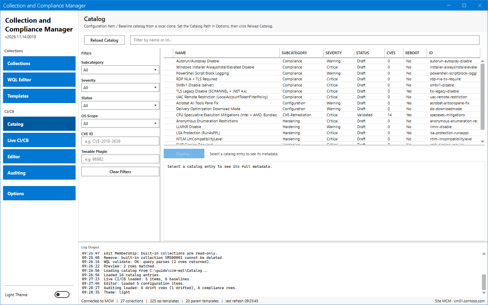
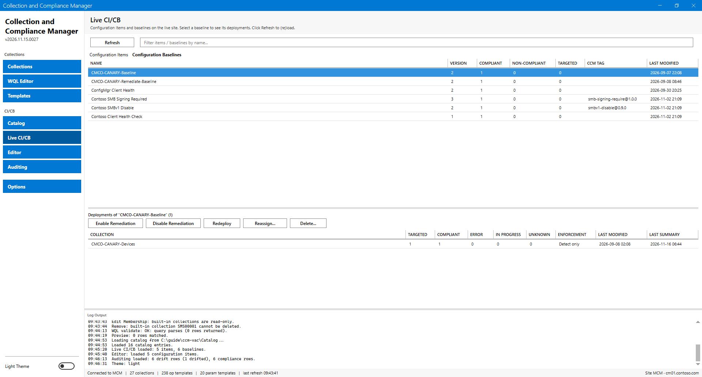
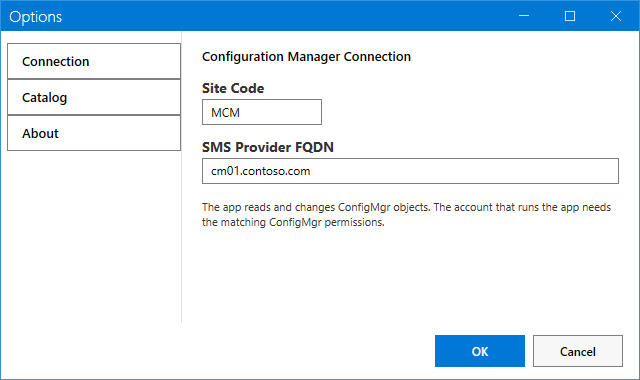
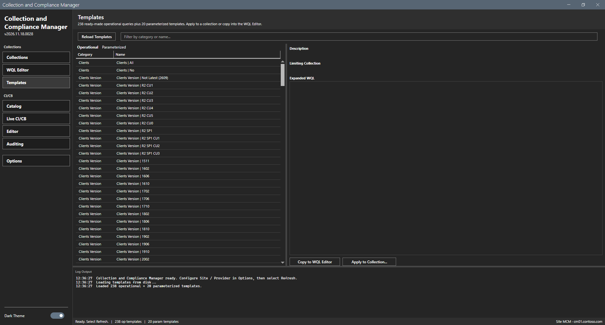

# Options dialog

The Options dialog sets the connection and the catalog path.

## What it does

The dialog has three pages: **Connection**, **Catalog** and **About**. **OK** saves. **Cancel** or Esc closes the dialog and keeps the old values.

## When to use it

Use it at the first start, when the site changes, and to point the tool at a catalog folder.

## Requirements

None.

## Steps

### Connection

Select **Options** in the sidebar.

| Field | Meaning |
|---|---|
| **Site Code** | The site code, for example `MCM`. The launcher chooses the site, so the box is read-only. See [Sites](#sites). |
| **SMS Provider FQDN** | The server with the SMS Provider role. The tool uses it for the PSDrive root. |

### Site in the footer

The footer of the main window shows the site on the right, for example `Site MCM - cm01.contoso.com`. It shows `Site not set` while the site code or the provider is empty. The footer is read-only. Select the site text to open Options. You change the provider here. The launcher changes the site code.

### Catalog

Type the **Catalog Path** or select **Browse...**. The folder holds the subcategory folders of the catalog. Leave the box empty to use the `Catalog` folder beside the script. The line below the box shows the folder in use. The tool stores no default path.

### Sites

The AppPackager Suite launcher chooses the site. The tool reads the site at the start and keeps its data per site in `%LOCALAPPDATA%\AppPackagerData\sites\<SITE>\tools\collection-and-compliance-manager`, for example `...\sites\AB1\tools\collection-and-compliance-manager`. That folder holds the `reports` folder and `prefs.json` with the site code and the SMS Provider of the site. A second site, for example `CD2`, has its own folder and shows none of the data of `AB1`.

- When the launcher has chosen a site, the **Site Code** box is read-only. Point to it to read why. The **SMS Provider FQDN** stays editable and is saved with the site.

- A tool that is open keeps its site until you restart it. When the launcher chooses another site, the footer shows a note, for example `The launcher now uses site CD2. This window keeps site AB1 until you restart it.`
- The first start after an update copies the old reports and the site settings into the folder of the site. It keeps the old files in the folder of the tool.

- Without the launcher, the tool takes the site code of its old `CCM.prefs.json` file, and the box is read-only too. To change that site code, edit the file. With no site code anywhere, the tool works as before: the box is editable and the files stay beside the script.

### About

The page shows the version and a short description.

### Theme

The **Dark Theme** switch at the bottom of the sidebar changes the theme. The tool keeps the choice. The theme changes colors only. Font size, weight and style stay the same. Every blue background shows white text.

### Start again

The tool saves the open view and the window place. After a restart the window shows the same view.

## Options and settings of this page

See the table above. [Settings](../reference/settings.md) lists the file keys.

## Limits

- A refresh needs both the site code and the provider.

## Troubleshooting

| Message or symptom | Cause | Fix |
|---|---|---|
| The status bar shows `Open Options to configure site code and SMS Provider, then refresh.` | The site code or the provider is empty. | Fill both fields. |

## Links

- [Settings](../reference/settings.md)
- [Getting started](../getting-started.md)
