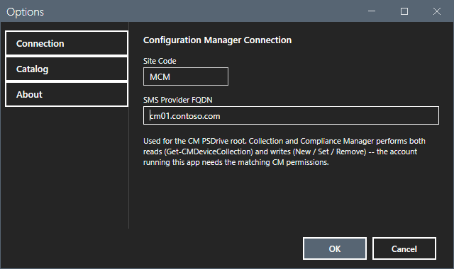
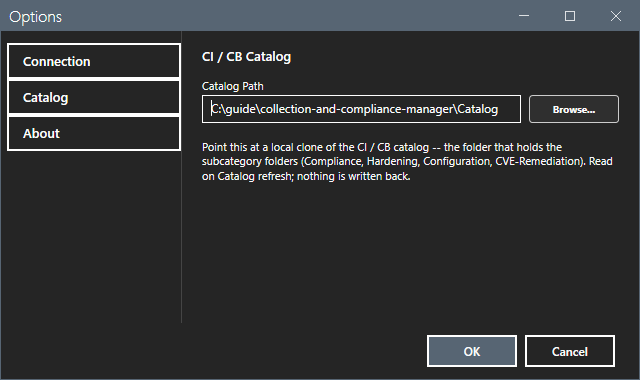
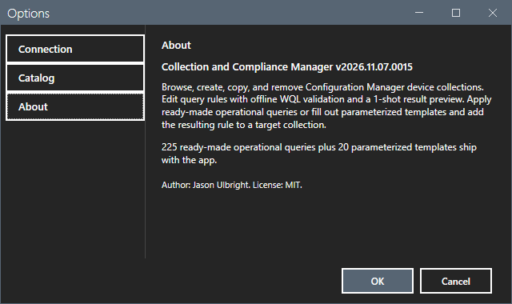
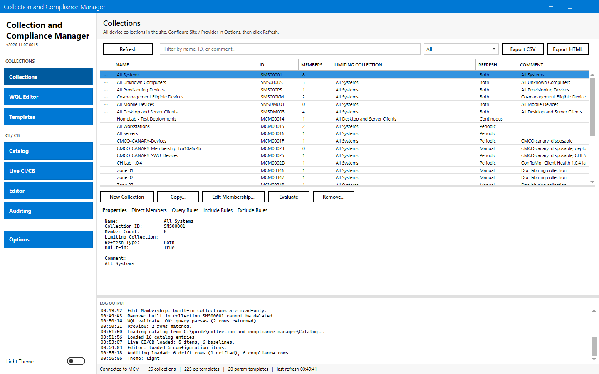
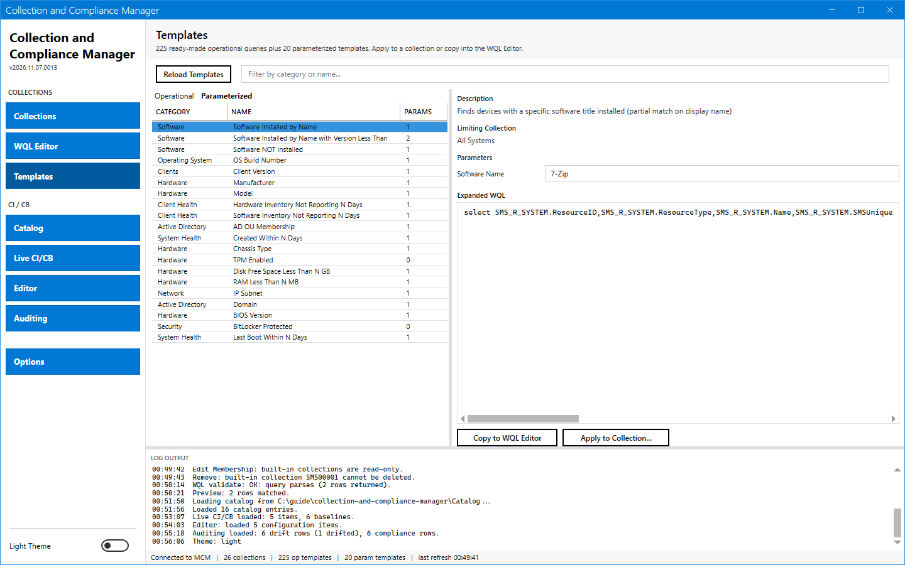
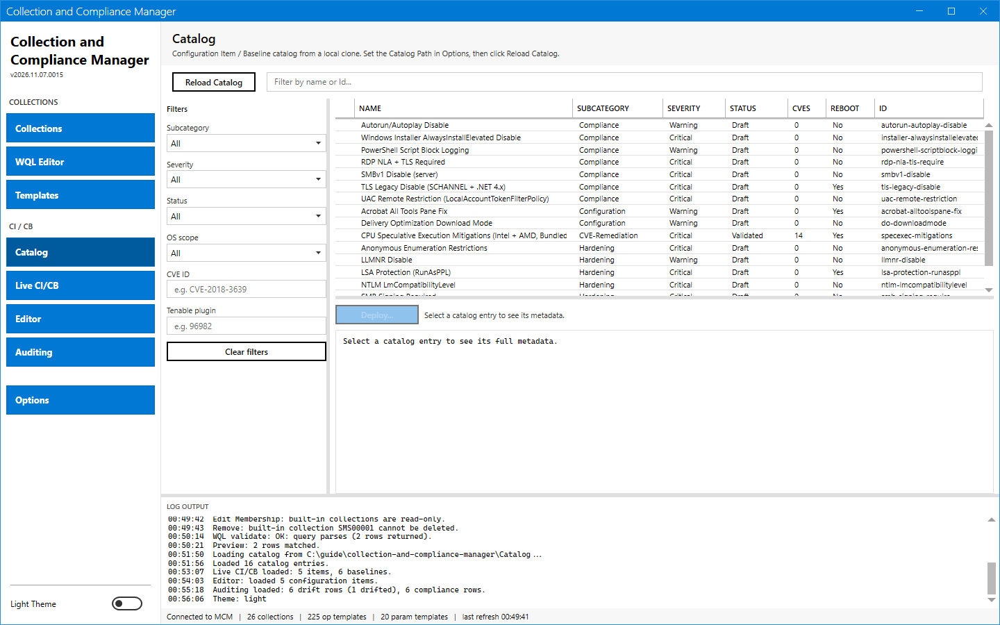
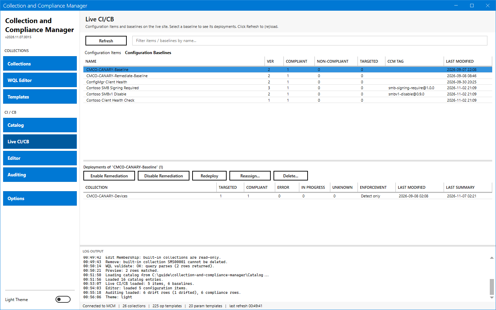
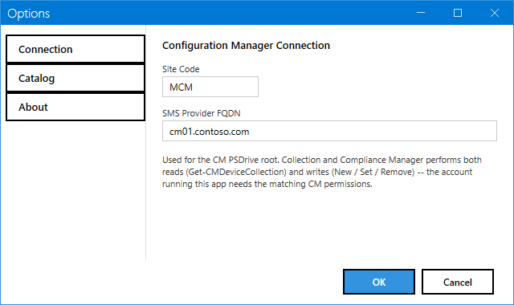
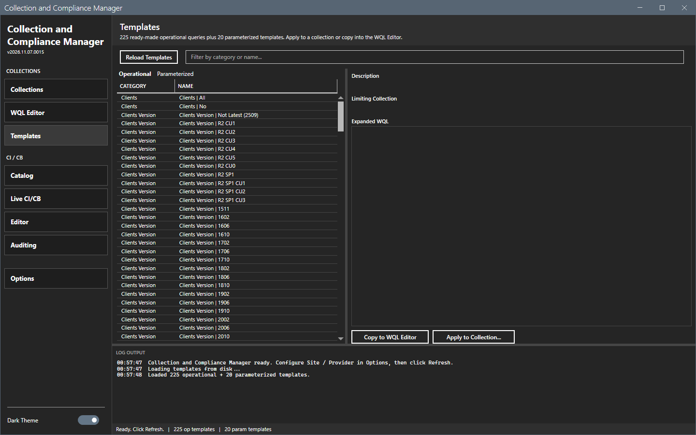

# Options dialog

The Options dialog sets the connection and the catalog path.

## What it does

The dialog has three pages: **Connection**, **Catalog** and **About**. **OK** saves. **Cancel** or Esc closes the dialog and keeps the old values.

## When to use it

Use it at the first start, when the site changes, and to point the tool at a catalog folder.

## Requirements

None.

## Steps

### Connection

Select **Options** in the sidebar.

| Field | Meaning |
|---|---|
| **Site Code** | The site code, for example `MCM`. |
| **SMS Provider FQDN** | The server with the SMS Provider role. The tool uses it for the PSDrive root. |

### Catalog

Type the **Catalog Path** or select **Browse...**. The folder holds the subcategory folders of the catalog. The default is the `Catalog` folder beside the script.

### About

The page shows the version and a short description.

### Theme

The **Dark Theme** switch at the bottom of the sidebar changes the theme. The tool keeps the choice.

### Start again

The tool saves the open view and the window place. After a restart the window shows the same view.

## Options and settings of this page

See the tables above. [Settings](../reference/settings.md) lists the file keys.

## Limits

- A refresh needs both the site code and the provider.

## Troubleshooting

| Message or symptom | Cause | Fix |
|---|---|---|
| The status bar shows `Open Options to configure site code and SMS provider, then refresh.` | The site code or the provider is empty. | Fill both fields. |

## Links

- [Settings](../reference/settings.md)
- [Getting started](../getting-started.md)
