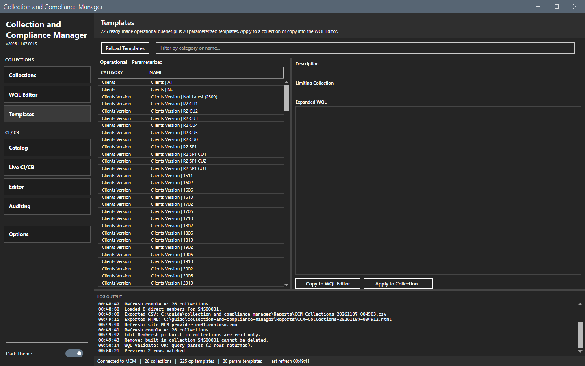
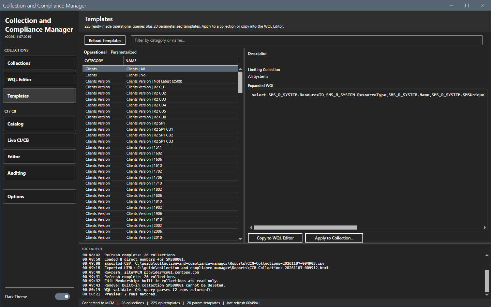
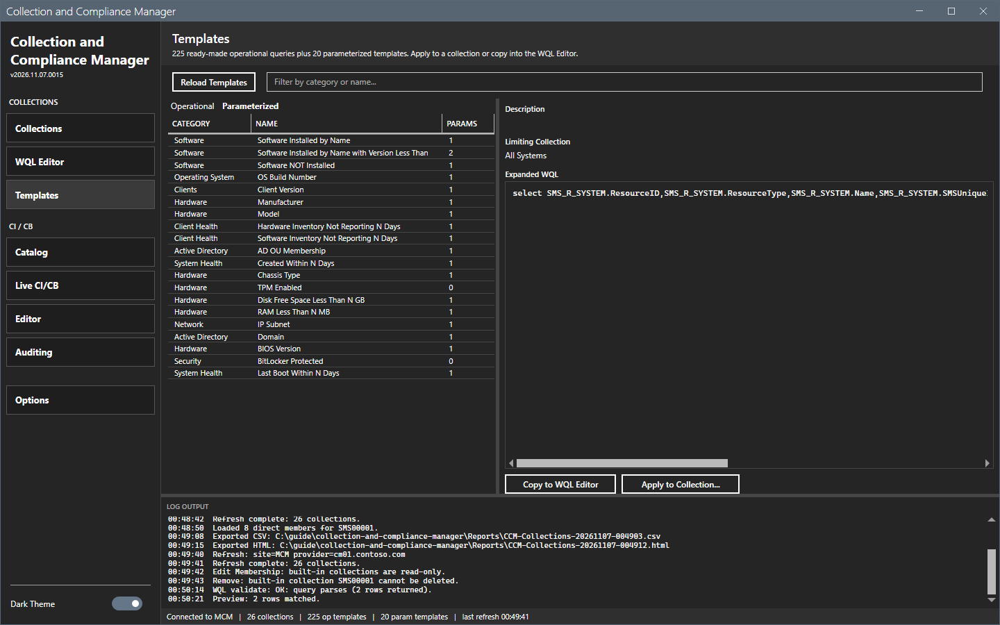
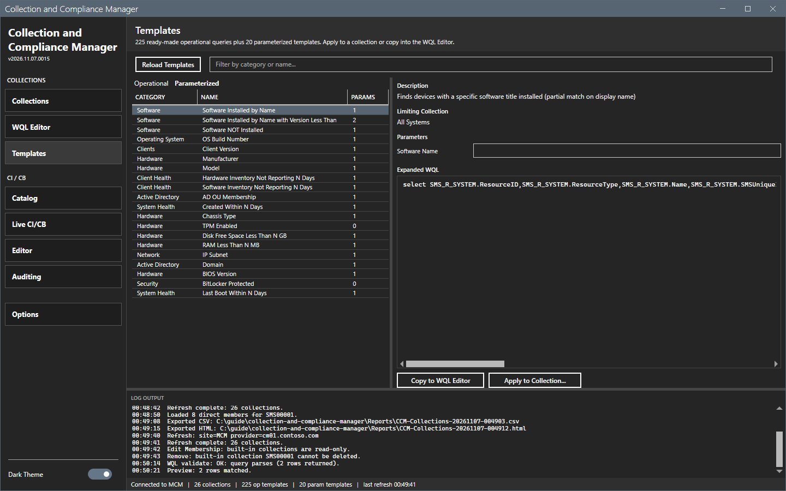
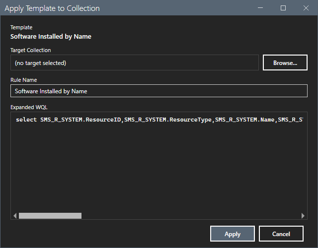

# Templates

The Templates view holds 225 ready-made operational queries and 20 parameterized templates.

## What it does

An operational template is a fixed query with a category, a name, a description and a limiting collection. A parameterized template has parameters. You fill the parameters and the expanded WQL updates at once. **Copy to WQL Editor** sends the query to the [WQL Editor](wql-editor.md). **Apply to Collection...** adds it as a rule to a collection.

## When to use it

Use it to start from a tested query instead of a blank editor.

## Requirements

- The templates load from `Templates` beside the script at the start. No connection is needed to read them.
- For **Apply to Collection...**: a refresh and the right to change the collection.

## Steps

### Read an operational template

1. Select **Templates** in the sidebar. The **Operational** tab shows the list.
2. Type text in the filter box to filter by category or name.
3. Select a row. The right side shows the description, the limiting collection and the expanded WQL.

### Fill a parameterized template

1. Select the **Parameterized** tab and select a row, for example `Software Installed by Name`.
2. Type a value in the parameter field. The expanded WQL updates as you type.

### Apply a template to a collection

1. Select a template and select **Apply to Collection...**. The dialog `Apply Template to Collection` opens.
2. Select **Browse...** to pick the collection. Confirm or change the rule name. The expanded query shows.
3. Select **Apply**. The log shows `Applied template "<name>" as rule "<rule>" on <collection>.`

This guide opened the dialog and cancelled it. The result of **Apply** was not checked.

## Options and settings of this page

| Control | Effect |
|---|---|
| **Reload Templates** | Reads the two JSON files again. |
| Filter box | Filters by category or name. |
| **Copy to WQL Editor** | Puts the expanded query in the editor. |
| **Apply to Collection...** | Adds the query as a rule. |

## Limits

- The templates are in `Templates\operational-collections.json` and `Templates\parameterized-templates.json`. The tool does not write to them.
- **Apply to Collection...** needs a refresh, because it lists the collections.

## Troubleshooting

| Message or symptom | Cause | Fix |
|---|---|---|
| `Template load failed:` | A JSON file is missing or damaged. | Restore the file and select **Reload Templates**. |
| The buttons are disabled. | No template is selected. | Select a row. |

## Links

- [WQL Editor](wql-editor.md)
- [Collections](collections.md)
