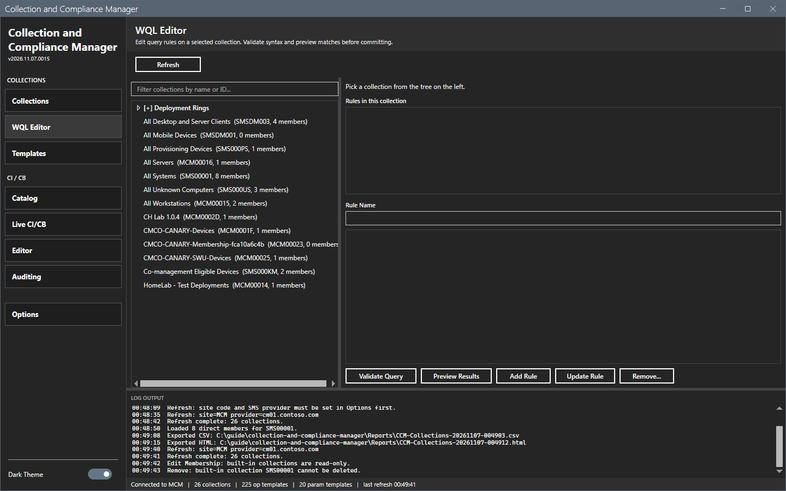
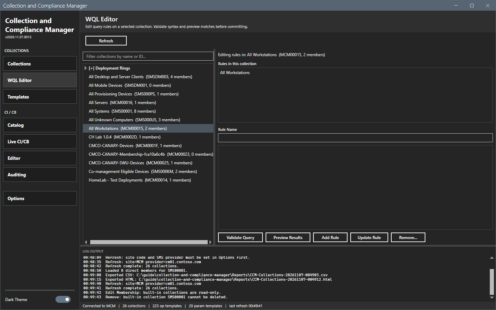
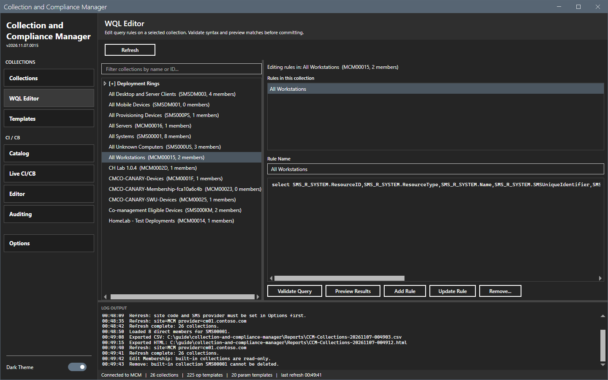
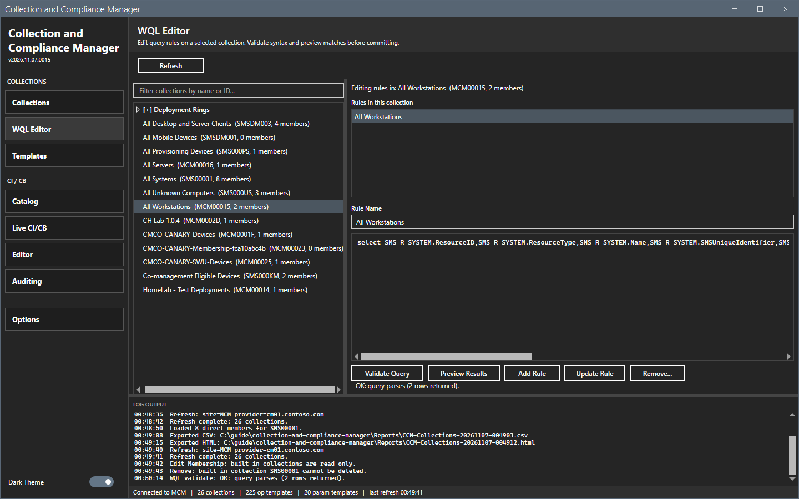

# WQL Editor

The WQL Editor edits the query rules of a collection.

## What it does

The tree lists the collections. Select one to see its query rules. The editor holds the WQL of the selected rule. **Validate Query** checks the syntax and **Preview Results** counts the matches. Both read the site and change nothing. **Add Rule**, **Update Rule** and **Remove...** change the collection.

## When to use it

Use it to write a new rule, to test a query before you apply it, and to change or remove a rule.

## Requirements

- A refresh on the Collections view or the **Refresh** button of this view.
- For **Add Rule**, **Update Rule** and **Remove...**: the right to change the collection.

## Steps

### Pick a rule

1. Select **WQL Editor** in the sidebar.
2. Type text in the tree filter to find a collection. Select a collection. The text above the rules shows `Editing rules in: <name> (<ID>, <n> members)`.
3. Select a rule in the list. The rule name and the WQL show in the editor.

### Validate and preview

1. Select **Validate Query**. The tool runs the query syntax check. The log shows `WQL validate: OK: query parses (<n> rows returned).`
2. Select **Preview Results**. The text next to the buttons shows `Preview: <n> rows matched.`

### Add, update or remove a rule

1. To add a rule, type a rule name and the WQL and select **Add Rule**. The log shows `Added rule "<name>" to collection <ID>.`
2. To change a rule, select it, change the name or the WQL and select **Update Rule**. If the site refuses the new rule, the tool adds the old rule back. The error says whether it did.
3. To remove a rule, select it and select **Remove...**, then confirm.

This guide did not add, update or remove a rule. The results of these buttons were checked from the code and the log texts only.

## Options and settings of this page

| Control | Effect |
|---|---|
| **Refresh** | Reads the collections again. |
| Tree filter | Filters the tree by name or ID. |
| **Validate Query** | Checks the syntax. |
| **Preview Results** | Counts the matches. |
| **Add Rule**, **Update Rule**, **Remove...** | Change the collection. |

## Limits

- The tool validates with the site. A query that parses can still match nothing.
- **Preview Results** gives a count, not the devices.

## Troubleshooting

| Message or symptom | Cause | Fix |
|---|---|---|
| The tree is empty. | No refresh has run. | Select **Refresh**. |
| `WQL validate:` shows an error. | The query has a syntax error. | Correct the query. |

## Links

- [Templates](templates.md)
- [Collections](collections.md)
