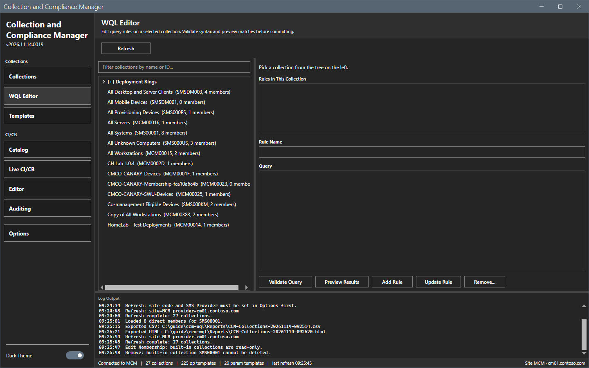
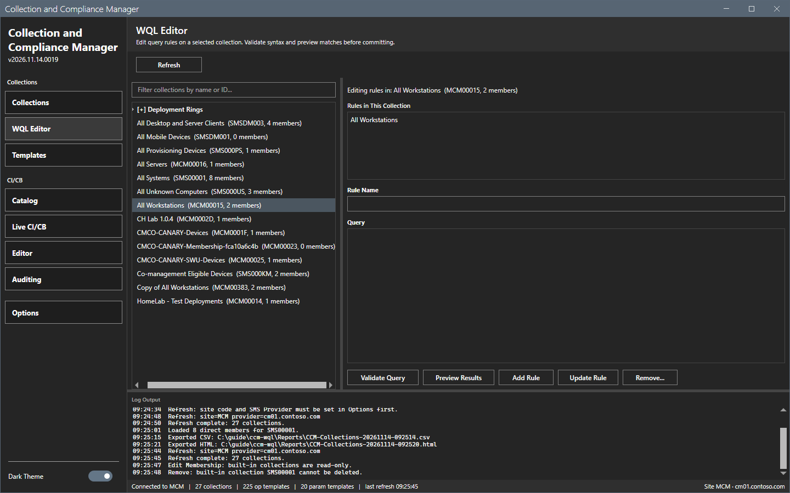
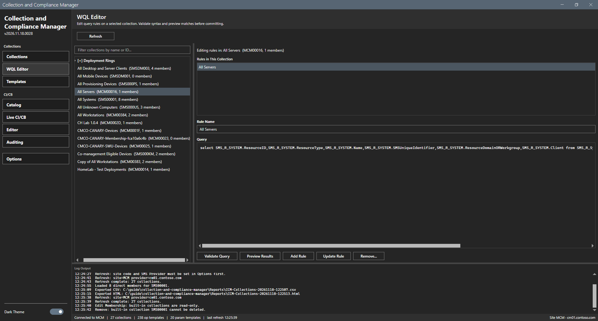
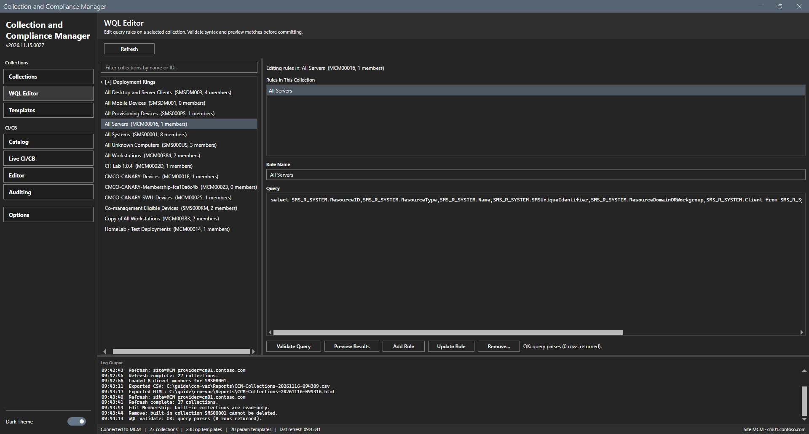
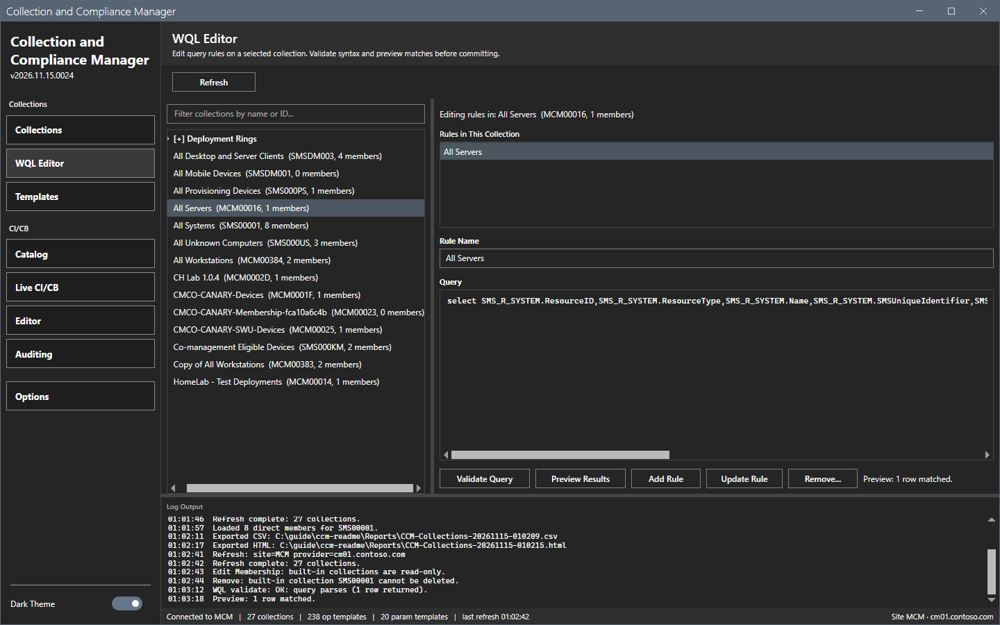

# WQL Editor

The WQL Editor edits the query rules of a collection.

## What it does

The tree lists the collections. Select one to see its query rules. The editor holds the WQL of the selected rule. **Validate Query** checks the syntax and **Preview Results** counts the matches. Both read the site and change nothing. **Add Rule**, **Update Rule** and **Remove...** change the collection.

## When to use it

Use it to write a new rule, to test a query before you apply it, and to change or remove a rule.

## Requirements

- A refresh on the Collections view or the **Refresh** button of this view.
- For **Add Rule**, **Update Rule** and **Remove...**: the right to change the collection.

## Steps

### Pick a rule

1. Select **WQL Editor** in the sidebar.
2. Type text in the tree filter to find a collection. Select a collection. The text above the rules shows `Editing rules in: <name> (<ID>, <n> members)`.
3. Select a rule in the list. The rule name and the WQL show in the editor.

### Validate and preview

1. Select **Validate Query**. The tool runs the query syntax check. The log shows `WQL validate: OK: query parses (<n> rows returned).`
2. Select **Preview Results**. The **Preview Results** window opens and runs the query on the site. The grid shows the returned rows, read only: Name and ResourceId first, then the other columns that the query selects (at most 12). The window shows at most 200 rows and the line `Showing <n> of <m> rows.` Select **Cancel** to end a long query. When the query has ended, the button reads **Close**. The text next to the buttons shows `Preview: <m> rows returned.` A query that fails shows `The preview failed. See the log file.` in the window.

### Add, update or remove a rule

1. To add a rule, type a rule name and the WQL and select **Add Rule**. The log is expected to show `Added rule "<name>" to collection <collection name>.`
2. To change a rule, select it, change the name or the WQL and select **Update Rule**. If the site refuses the new rule, the tool adds the old rule back. The error says whether it did.
3. To remove a rule, select it and select **Remove...**, then confirm.

This guide did not add, update or remove a rule. The behavior of these buttons was read from the code only. They were not run.

## Options and settings of this page

| Control | Effect |
|---|---|
| **Refresh** | Reads the collections again. |
| Tree filter | Filters the tree by name or ID. |
| **Validate Query** | Checks the syntax. |
| **Preview Results** | Opens a window with the returned rows in a read-only grid. **Cancel** ends a long query. |
| **Add Rule**, **Update Rule**, **Remove...** | Change the collection. |

## Limits

- The tool validates with the site. A query that parses can still match nothing.
- **Preview Results** shows the first 200 rows. **Validate Query** gives the count of all rows.

## Troubleshooting

| Message or symptom | Cause | Fix |
|---|---|---|
| The tree is empty. | No refresh has run. | Select **Refresh**. |
| `WQL validate:` shows an error. | The query has a syntax error. | Correct the query. |
| The text next to the buttons shows `Refresh first to establish a CM connection.` | No connection is open. | Select **Refresh** and try again. |
| The **Preview Results** window shows `The preview failed. See the log file.` | The site could not run the query. | Review the log. |

## Links

- [Templates](templates.md)
- [Collections](collections.md)
