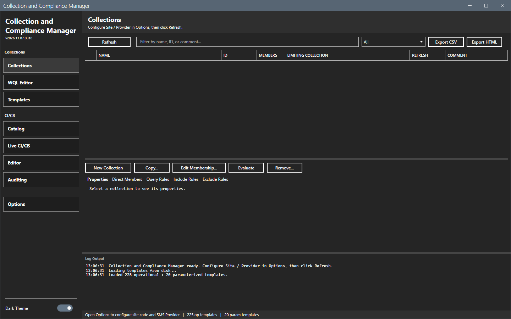
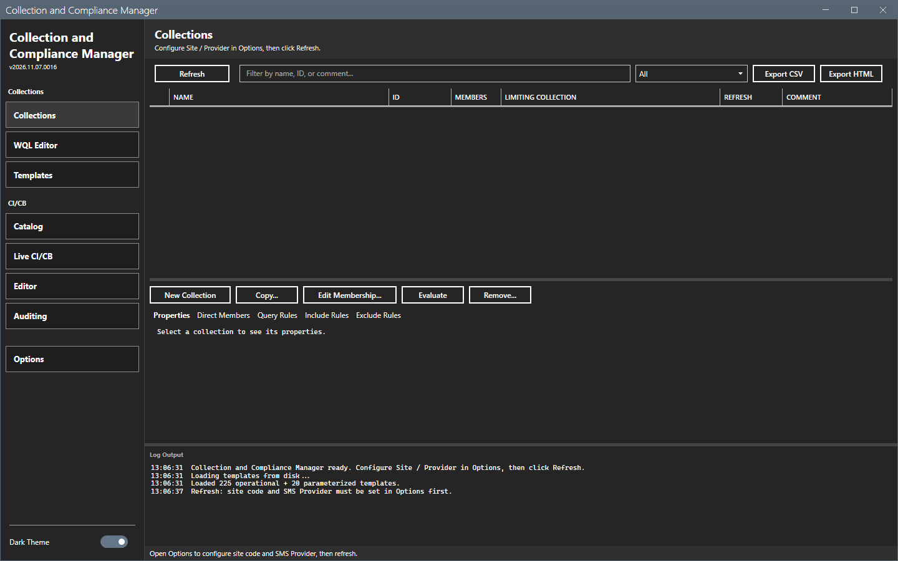
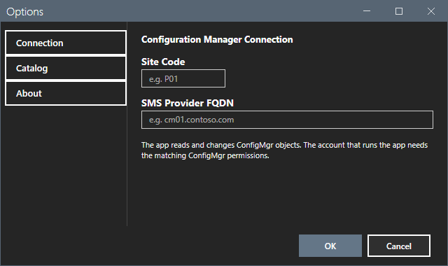
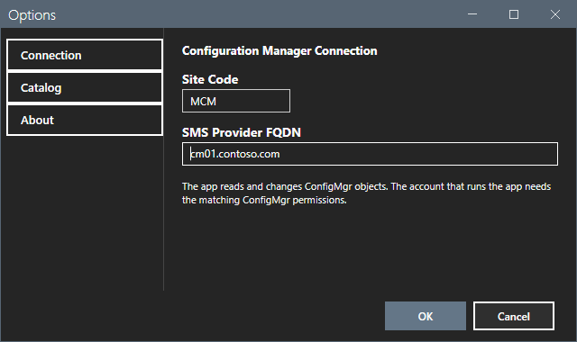
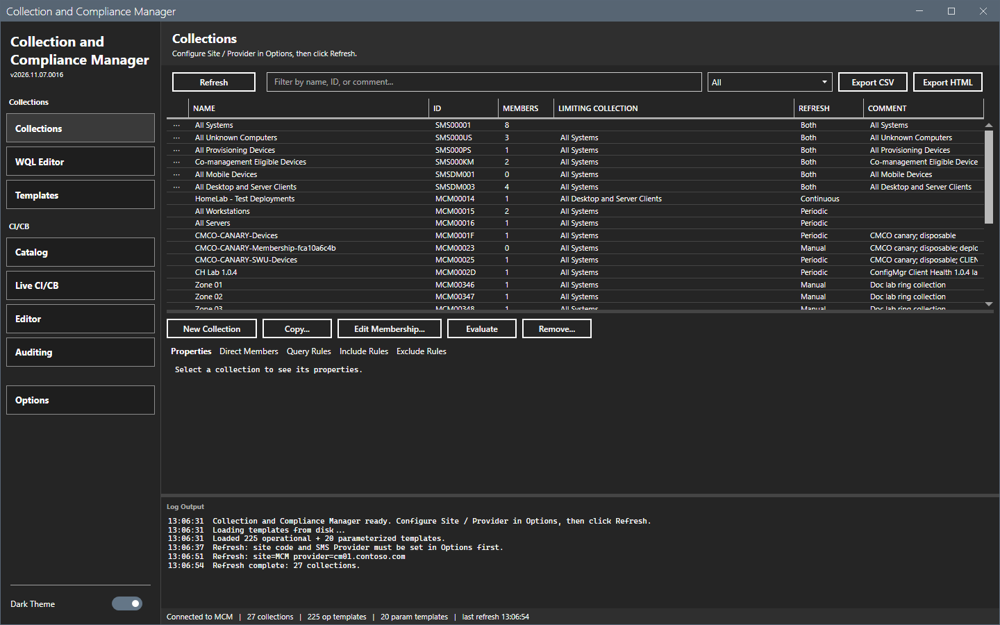

# Getting started

This page shows how to start Collection and Compliance Manager, set the connection and load the collections.

## What it does

The tool reads and changes the device collections, the query rules and the compliance baselines of a Configuration Manager site through its SMS Provider. It has seven views and an Options dialog.

## When to use it

Use it to create or copy collections, to write and test WQL query rules, to apply ready-made queries, and to deploy, audit and edit configuration items and baselines.

## Requirements

- Windows 10 or Windows 11, PowerShell 5.1 and .NET Framework 4.7.2 or later.
- The Configuration Manager console. The tool loads the `ConfigurationManager` PowerShell module of the console. Without the console, **Refresh** fails with a message in the log. See [Error messages](reference/error-messages.md).
- Rights on the site for what you do. A read needs read rights. New, Copy, Edit Membership, Evaluate, Remove, Add Rule, Deploy and the Live and Editor actions change the site. See [Permissions](reference/permissions.md).

## Steps

### Start the tool

1. Extract the release zip to a folder that you can write to. The tool saves its settings, logs and reports in that folder.
2. Right-click `start-ccm.ps1` and select **Run with PowerShell**. Or run this command:

```powershell
powershell -ExecutionPolicy Bypass -File start-ccm.ps1
```

The window opens on the Collections view. The window of the first start is empty. The templates load from disk at the start: the log shows `Loaded 225 operational + 20 parameterized templates.`



If you select **Refresh** before you set the connection, the log asks you to open Options.



### Set the connection

1. Select **Options** in the sidebar.
2. Type the **Site Code**, for example `MCM`.
3. Type the **SMS Provider FQDN**, for example `cm01.contoso.com`.
4. Select **OK**.





### Load the collections

1. Select **Refresh**. A progress overlay shows.
2. Wait for the status bar to show the number of collections.




## Options and settings of this page

None. The settings are on [Options dialog](core/options.md).

## Limits

- Every view that reads the site needs a refresh first. A view is empty until then.
- The window opens on the view that was open when you closed it.

## Troubleshooting

| Message or symptom | Cause | Fix |
|---|---|---|
| The log shows `Refresh: site code and SMS Provider must be set in Options first.` | The site code or the provider is empty. | Set the connection. |
| The log shows `ConfigurationManager module not found`. | The console is not installed on this computer, or `SMS_ADMIN_UI_PATH` does not point to the `bin\i386` folder of the console. | Install the console. If it is installed, set `SMS_ADMIN_UI_PATH` to its `bin\i386` folder and start the tool again. |

## Links

- [Collections](core/collections.md)
- [Options dialog](core/options.md)
- [Troubleshooting](troubleshooting.md)
