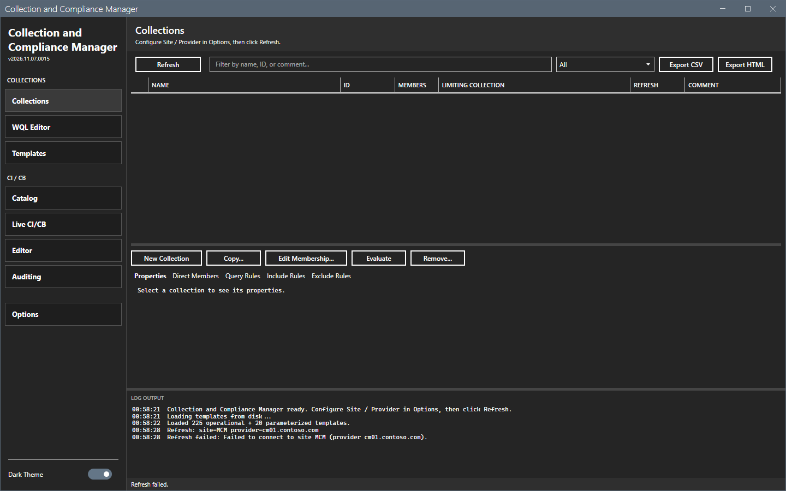

# Error messages

This page lists the messages of Collection and Compliance Manager with cause and fix. The messages show in the log pane and in the status bar.

## What it does

It maps a message to its cause and to a fix.

## When to use it

Use it when a refresh or a change does not work.

## Requirements

None.

## Messages

| Message | Where | Cause | Fix |
|---|---|---|---|
| `Open Options to configure site code and SMS provider, then refresh.` | Status bar | The site code or the provider is empty. | Set both in **Options > Connection**. |
| `Refresh: site code and SMS provider must be set in Options first.` | Log | The same. | The same. |
| `ConfigurationManager module not found.` | Log | The console is not installed on this computer, or `SMS_ADMIN_UI_PATH` does not point to the `bin\i386` folder of the console. | Install the console. If it is installed, set `SMS_ADMIN_UI_PATH` to its `bin\i386` folder and start the tool again. |
| `Refresh failed:` and `Refresh failed.` | Log, status bar | The tool could not connect or read. | Read the log line for the reason. |
| `Edit Membership: built-in collections are read-only.` | Log | The collection is built-in. | Select a custom collection. |
| `Remove: built-in collection <ID> cannot be deleted.` | Log | The same. | The same. |
| `Add direct member: no device was added for "<name>".` | Log | The name does not match one device, or the lookup failed. | Type the exact device name. |
| `WQL validate:` followed by an error | Log | The query has a syntax error. | Correct the query. |
| `Catalog path not found:` and `Open Options and set the Catalog Path` | Log, status bar | The catalog path is empty or wrong. | Set the **Catalog Path**. |
| `Deploy needs a site connection -- Refresh first.` | Status bar | No refresh has run. | Select **Refresh**. |
| `Deploy blocked: <n> dependency/dependencies missing:` | Log | A dependency of the catalog entry is missing on the site. | Create the dependency, then open **Deploy...** again. |
| `Deploy: <entry> has schema issues; not deployable.` | Log | The metadata of the entry is not valid. | Correct the metadata. |
| `Editor: "<name>" is a <type> setting -- only Registry and Script settings can be edited here.` | Log | The setting type is not editable. | Use the console. |

The image shows a refresh on a computer without the console. The window stays open, the grid stays empty and the log names the cause.

## Steps

1. Find the message in the table.
2. Do the fix.
3. Run the action again.

## Limits

- The messages are in English.

## Troubleshooting

See [Troubleshooting](../troubleshooting.md).

## Links

- [Troubleshooting](../troubleshooting.md)
- [Permissions](permissions.md)
