# Light theme check

This page shows the light theme states of the tool. Every blue background carries white text.

## What it does

The capture tool opens each state in the light theme, reads the screen colors of the control and writes them to its log. This page lists the colors from the last run.

## When to use it

Use it after a change to a style, a dialog or the shared theme library.

## Requirements

The same as [Capture the images again](capture-images.md).

## Steps

1. Run the capture command with the `-OutDir` parameter.
2. Read the `steps-guide.run.log` file in that folder. Each `SAMPLE` line has the background color, the text color and the contrast ratio.
3. Open the images that this page shows and compare them with the colors.

## Colors read from the screen

| State | Background | Text | Contrast |
|---|---|---|---|
| grid selected row | `#3393DF` | `#FFFFFF` | 3.3 |
| inline-button normal | `#FFFFFF` | `#000000` | 21.0 |
| inline-button hover | `#E0E0E0` | `#000000` | 15.9 |
| inline-button pressed | `#000000` | `#FFFFFF` | 21.0 |
| sidebar active | `#005A9E` | `#FFFFFF` | 7.1 |
| sidebar options | `#0078D4` | `#FFFFFF` | 4.5 |
| sidebar-button normal | `#0078D4` | `#FFFFFF` | 4.5 |
| sidebar-button hover | `#0078D4` | `#FFFFFF` | 4.5 |
| sidebar-button pressed | `#0078D7` | `#FFFFFF` | 4.5 |
| selected tab | `#FFFFFF` | `#000000` | 21.0 |
| combo selected item | `#3393DF` | `#FFF3EA` | 3.0 |
| dialog-button normal | `#F7F7F7` | `#000000` | 19.6 |
| dialog-button hover | `#E0E0E0` | `#000000` | 15.9 |
| dialog-button pressed | `#000000` | `#FFFFFF` | 21.0 |
| dialog-accent-button normal | `#0078D7` | `#FFFFFF` | 4.5 |
| dialog-accent-button hover | `#004881` | `#FFFFFF` | 9.4 |
| dialog-accent-button pressed | `#000000` | `#FFFFFF` | 21.0 |
| members grid selected row | `#3393DF` | `#FFFFFF` | 3.3 |
| collection tree selected item | `#3393DF` | `#FFFFFF` | 3.3 |
| rule list selected item | `#3393DF` | `#FFFFFF` | 3.3 |
| template selected row | `#3393DF` | `#FCFDFD` | 3.2 |
| catalog selected row | `#3393DF` | `#FFFFFF` | 3.3 |
| accent-inline-button normal | `#0078D7` | `#FFFFFF` | 4.5 |
| accent-inline-button hover | `#004881` | `#FFFFFF` | 9.4 |
| accent-inline-button pressed | `#000000` | `#FFFFFF` | 21.0 |
| deploy dialog accent button | `#0078D7` | `#FFFFFF` | 4.5 |
| options accent button | `#0078D7` | `#FBFCFD` | 4.4 |

A selected row, list item or tree item shows white text on the accent blue. A button that is pressed shows white text on black. A button that the pointer is over shows black text on light gray. The sidebar buttons show white text on blue.

## Images

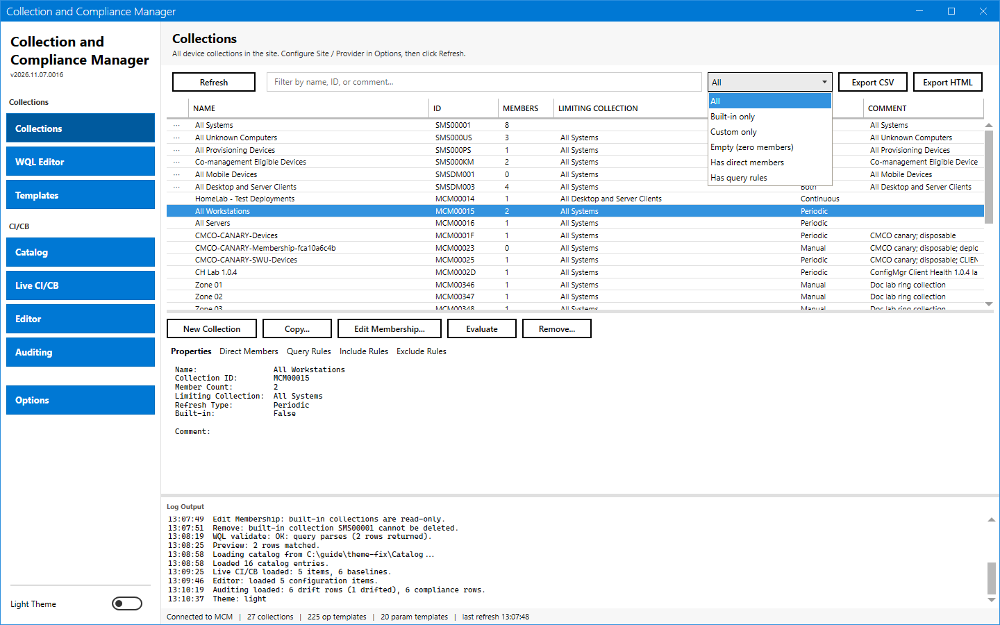

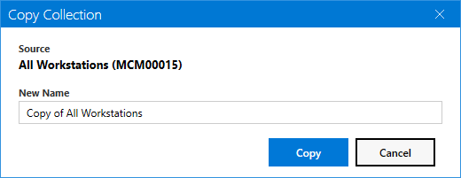

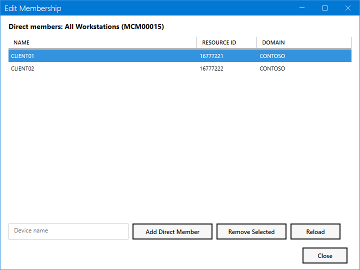

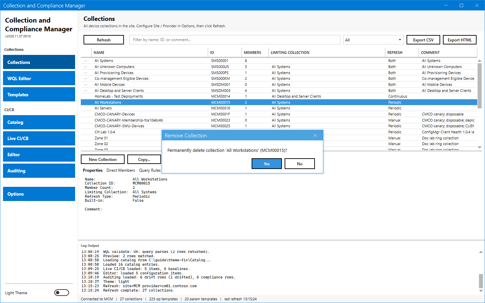

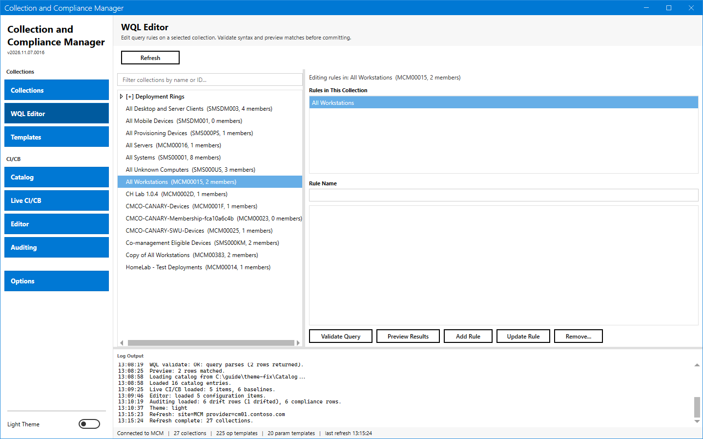

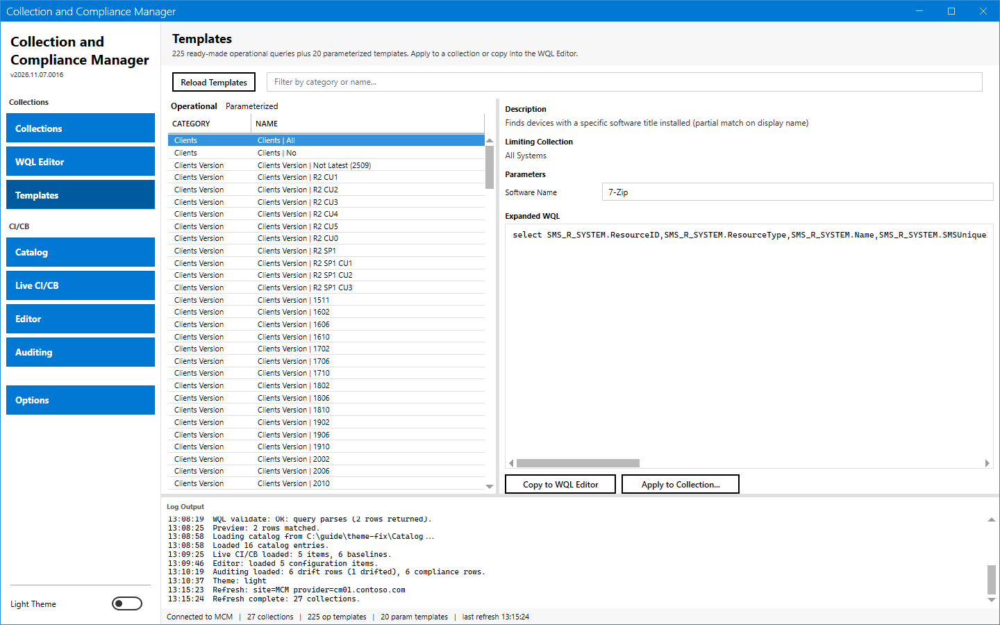

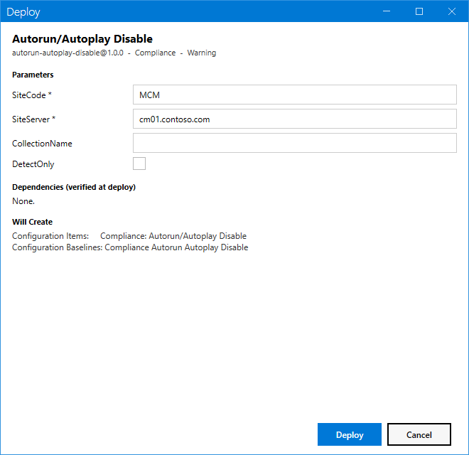

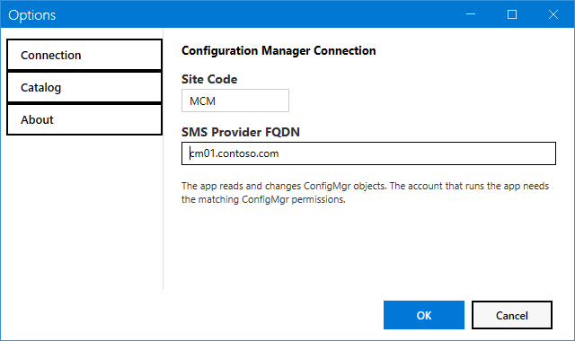

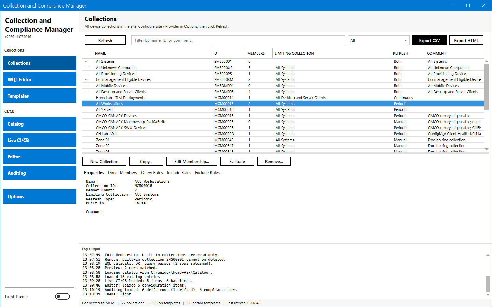

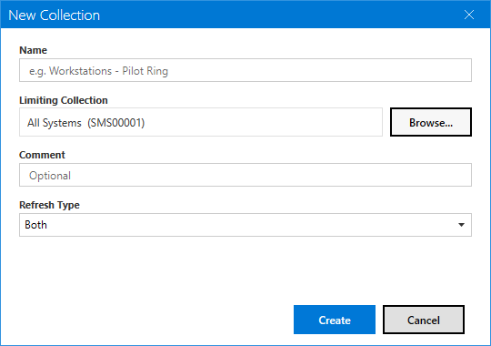

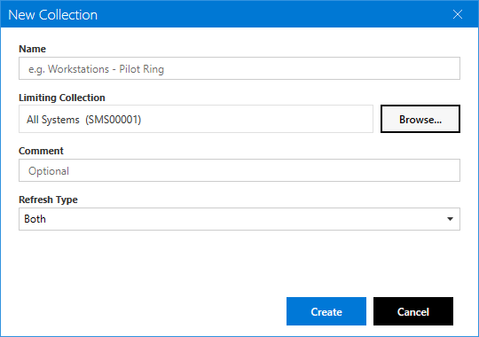

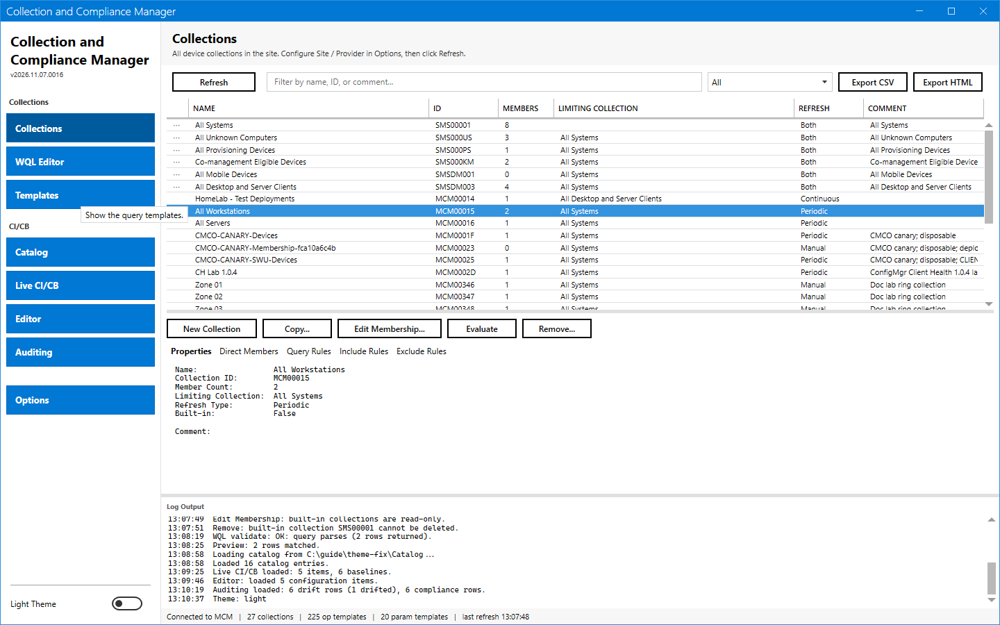

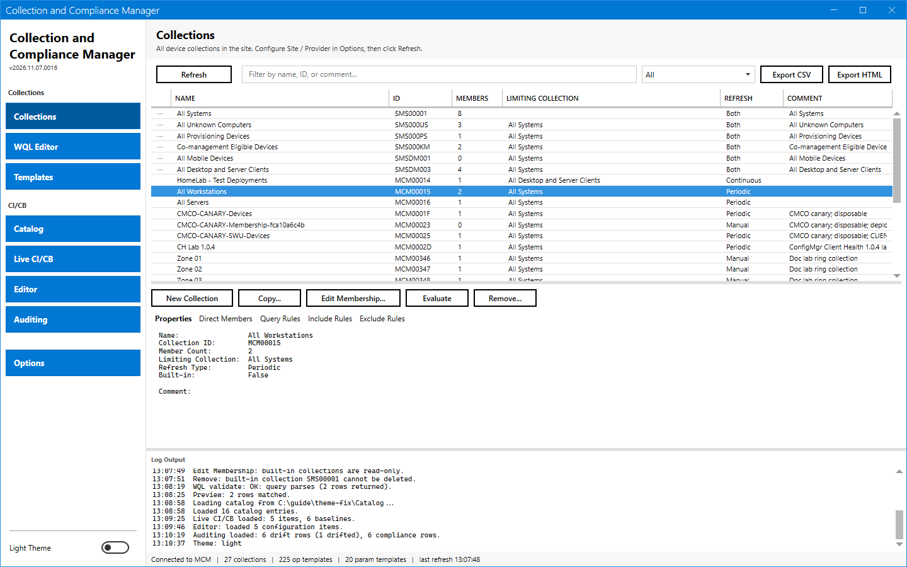

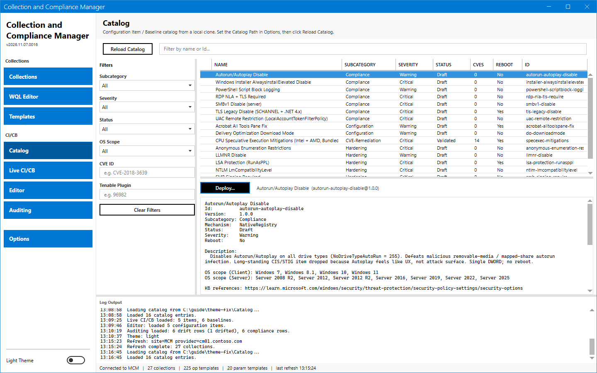

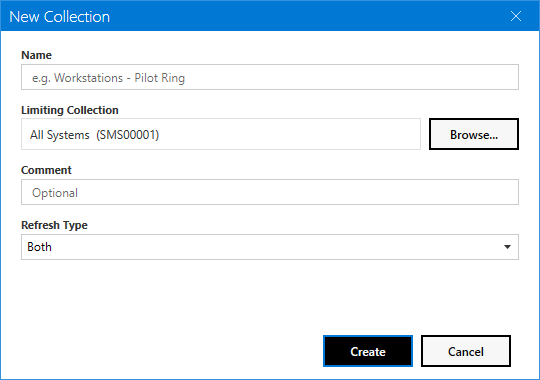

## Limits

- The capture shows no disabled button in this theme state, so the page has no disabled sample.
- The buttons take the accent base color, which gives white text 4.5:1. The selected rows and items use the lighter accent color, which gives white text 3.2 to 3.3:1. The shared theme library owns this color.

## Links

- [Index](../index.md)
